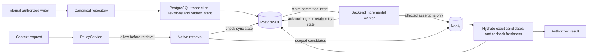
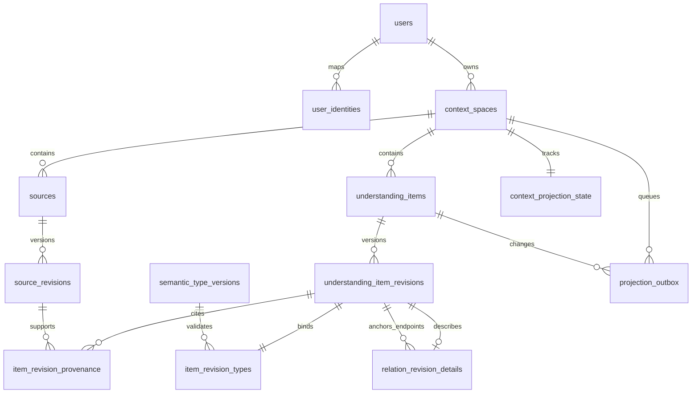
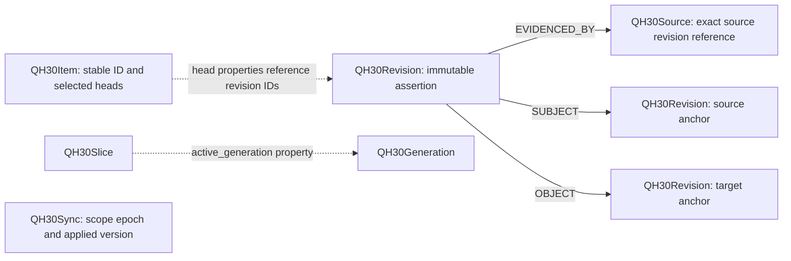

# QH

QH is a sovereign context platform: people preserve, query, govern and selectively
share persistent understanding through Context Spaces, independently of AI providers.
Stable identity, immutable revisions, explicit validation and traceable evidence keep
interpretations distinct from their sources and substantial decisions human-controlled.
A space can contain multiple domains without a separate schema for each.

## Implementation status

Status aligned with GitHub and Jira on **2026-10-17**. Code merged into `main`
and code running on the VPS are separate checkpoints. The later owner-authorized
hot-reload POC below activates the application UI/API, without running extraction.

| Layer | State |
| --- | --- |
| Consolidated `main` | Native foundation, QH-8 extraction/evaluation, QH-32 citation resolution and QH-33 technical delivery merged. [PR #8](https://github.com/bl000m/qh/pull/8) merge: `a7a2da3e43fca3fbcd54dd743956c14e0fa599e2`; its head CI passed quality, OIDC and 383 native tests without skips |
| QH environment | Owner-authorized VPS development POC: QH-12 frontend/backend run from `/home/ubuntu/qh` with hot reload; schema 0005, native worker/namespace unchanged. MCP retains c723d32 image-only operation. [Current commands, backup and limits](docs/qh-development-stack.md) |
| Semantic foundation | Three generic profiles provisioned; authorized exact descriptor selection active. Historical type bindings, canonical revisions and six Graphiti nodes preserved. [Deployment record](docs/deployments.md) |
| QH-8 merged internal pipeline | Conversation import, interchangeable fake/replay providers, strict citations and generic proposed understanding; isolated SQL/Neo4j verification. The internal pipeline is in `main`, not deployed as a conversational product flow |
| Merged Mistral experiment evidence | Four full synthetic `mistral-small-2603` generations on 2026-10-16; 7/8 cumulative requests, 2,673 input / 5,922 output tokens, USD 0.00392283 cache-aware calculated usage charge. One of four QH batches accepted; 23/34 citation spans exact. Provisional reference, no independent human validation. [Report](docs/qh8-mistral-evaluation.md) |
| QH-32 merged offline follow-up | One Understanding Engine/two governed inputs documented in ADR 0004; unique exact quote resolution on the four frozen captures raises contract-valid batches from 1/4 to 3/4. Missing evidence still rejects the full batch; semantic errors remain. [Follow-up](docs/qh8-citation-followup.md) |
| QH-33 technical delivery DONE | Reproducible v2 benchmark, separate provisional metrics, offline comparisons and integrity checks. All 74 human decisions remain pending in [QH-38](https://contextlab.atlassian.net/browse/QH-38); `human_review.metrics=null`. [Closure record](docs/qh33-closure-scope.it.md) |
| Future | Source Vault (QH-31), Domain Packs, verified real-provider extraction quality, embedding cache and advanced vector/hybrid retrieval; product context operations through MCP |

Graphiti is a preserved historical prototype, not a native-engine dependency.
The independent MCP server currently provides transport scaffolding, not a QH context
client. Deployed retrieval offers scoped substring search and an internal exact
descriptor selector: authorize → canonical IDs from SQL → Neo4j verification →
canonical hydration and freshness recheck. QH-10 exposes its bounded authenticated
query contract; no semantic ranking is implied. The sole development checkout is `/home/ubuntu/qh`, using one
task branch at a time. Frontend/backend now follow that branch: stop the apps
before switching. The frozen image-only bundle is retained for rollback.

## Contextual chat — QH-13 review candidate

[QH-13](docs/qh-13-contextual-chat.md) adds the complementary **Discuter avec ce
contexte** action to the browse-first Space page. The default provider is a clearly
labelled deterministic mock. It uses only bounded authorized confirmed-current
records, with explicit opt-in for unconfirmed proposals and expandable canonical
references; history is excluded. Answers and dialogue are ephemeral and never
write Understanding State. Mistral configuration is prepared but remains disabled
until separately authorized; no API key is exposed to the browser. See
[ADR 0006](docs/adr/0006-scoped-contextual-chat.md) for policy and limits.

## Demo A preparation and next UX direction — 2026-10-17

The [three-Space operational plan](docs/qh-13-demo-a-plan.md) reuses the original
QH-8 project/health/personal fixtures: 18 proposed revisions, three sources and new
Alice-owned Spaces. The owner subsequently authorized the persistent seed: [execution on
2026-10-18](docs/qh-13-demo-a-execution.md) passed canonical/worker and real-stack
Alice/Bob/browser checks; all three populated Spaces are retained. The later
[owner-review corrections](docs/qh-13-review-corrections.md) fix React sibling keys,
label mock output as excerpts without question understanding and compact full
canonical context losslessly: all six fixture revisions now fit for the measured
initial questions. Larger contexts/dialogue can still exceed the unchanged caps.
The [exact synthetic Mistral gate](docs/evidence/qh13-mistral-chat-gate-20261018/README.md)
was subsequently approved for a first bounded run: the
[real trial](docs/qh-13-mistral-chat-experiment.md) stopped after one inference
because three returned IDs were item IDs rather than revision IDs. QH rejected
the answer; the other two inferences were not run. Public chat is verified mock,
the ledger is blocked 2/4, and no general live-provider window is active.

[The subsequent alias correction](docs/qh-13-reference-aliases.md) introduces only
an internal request-local reference map and deterministic warnings for unconfirmed
support; public citations and canonical data are unchanged. A
[new one-question manifest](docs/evidence/qh13-mistral-alias-gate-20261018/README.md)
is prepared with a separate blocked ledger and USD 0.01 proposed cap. No new
inference is authorized or executed; aliases do not establish semantic support.

The owner-approved [Product Contract amendment](docs/product/QH_PRODUCT_CONTRACT.md#demo-a-experience--owner-amendment-2026-10-17)
sets the **next**, separately scoped UX increment: login to `Mon environnement`,
Space overview, primary contextual chat, expandable `Explorer la compréhension`
and supplied QH branding. The current QH-13 layout and OIDC flow are unchanged.
The presentation's future Domain hierarchy creates no Domain model or sharing.
The owner confirmed the scope; [QH-43](https://contextlab.atlassian.net/browse/QH-43)
is created, **À faire**, awaiting QH-13 closure and owner assets before implementation. Real Mistral remains separately consented/budgeted, maximum EUR 5.

## Planned demo sequence — 2026-10-17

**QH-9 merged:** [authenticated Space metadata REST](docs/qh-9-context-spaces.md)
implements POST/list/detail/PATCH-name through the existing ContextService,
OIDC identity, PolicyService and canonical PostgreSQL. It is a merged increment
of Demo A; its routes are now active in the authorized hot-reload POC. No deletion
or ingestion flow is added.

**QH-10 merged:** [scoped canonical retrieval](docs/qh-10-scoped-retrieval.md)
adds one authenticated query route for native text search or exact open descriptors,
with mandatory current/proposed/history selection, canonical content, validation,
revision anchors, source provenance and time bounds. This source increment is not
active in the hot-reload POC; it adds no LLM generation, temporal filtering or sharing.

**QH-11 merged:** [Mon environnement](docs/qh-11-mon-environnement.md) adds
real browser OIDC login, owned Space list/create/detail and return navigation to the
existing React client. Code + PKCE uses the approved ephemeral in-memory session;
no sharing or new session backend. QH-11 and the QH-9/10 API are now active in the
authorized VPS POC; MCP alone retains the earlier c723d32 app image.

**QH-12 merged:** [structured Context detail](docs/qh-12-context-understanding.md)
opens with a deterministic structured preview and bounded no-selector navigation;
QH-10 text/open-descriptor search remains complementary. It preserves
canonical revisions, state, temporal bounds, source provenance and relation anchors.
The owner-approved [ADR 0005](docs/adr/0005-browse-first-context-understanding.md)
records browse-first rationale, alternatives and limits. No fabricated search,
editing or automatic confirmation. The owner authorized
[hot-reload VPS activation before merge](docs/qh-development-stack.md); PR #13
was merged as `92dc300c03147a7fb7978203d97f2320c8c3051f`; Jira QH-12 is DONE. Existing Understanding data remain under
their original synthetic owners; Alice's new empty Space has no extracted items.

The roadmap rows below describe target milestones; the status paragraphs above
identify which increments are already implemented and active.
They reuse the [Product Contract](docs/product/QH_PRODUCT_CONTRACT.md), native engine
[ADR 0003](docs/adr/0003-native-context-engine.md) and unified Understanding Engine
[ADR 0004](docs/adr/0004-unified-understanding-engine.md).

| Milestone | Jira scope | Observable outcome and boundary |
| --- | --- | --- |
| Demo A: inspect a Context Space | [QH-9](https://contextlab.atlassian.net/browse/QH-9), [QH-10](https://contextlab.atlassian.net/browse/QH-10), [QH-11](https://contextlab.atlassian.net/browse/QH-11), [QH-12](https://contextlab.atlassian.net/browse/QH-12) | Authenticated CRUD, scoped retrieval and browser views with sources/revisions. May use synthetic data acquired by the existing pipeline; no claim of live AI updates |
| Conversational understanding update | [QH-13](https://contextlab.atlassian.net/browse/QH-13), [QH-39](https://contextlab.atlassian.net/browse/QH-39) | Chat uses scoped retrieval/LLMProvider; QH-39 separately connects authorized conversation → source revision → validated `proposed` understanding → existing repository/outbox. Reuse the same Engine; a chat answer is not a canonical write or confirmation |
| Demo B: Alice shares with a guest | [QH-40](https://contextlab.atlassian.net/browse/QH-40), QH-14–16 and QH-18–22 | Manual selection, exact preview, immutable Approved Snapshot, expiring/revocable link and guest access restricted to that snapshot. QH-17's natural-language suggestion is optional; no MCP prerequisite |
| Complete demo with MCP (Demo C) | [QH-26](https://contextlab.atlassian.net/browse/QH-26), QH-23–25 | Reuse verified Demo B; add real MCP discovery/preview/retrieve and cross-channel isolation. Future MCP proposal-write QH-34 is a different ingress, not this demo's read transport |

Demo B may reuse a verified synthetic dataset. Any demonstration of understanding
changing **live from chat** requires QH-39 to have been verified; it must not be
simulated. Share approval authorizes disclosure, not the truth of `proposed` items.
New Space revisions never expand an approved snapshot; guest questions use only its
authorized materialized revisions, with policy checks before retrieval/provider
disclosure. Real-provider use requires separate consent/budget authorization.
Independent human benchmark validation remains QH-38, not a completed demo gate.

## Architecture and data flow

The diagram describes the implemented QH-30 path, tested in isolation and activated
on the VPS at the pinned cutover commit. The worker
runs in the backend process; no broker or new microservice is required. Core stays
independent of FastAPI, database drivers and provider SDKs.



Canonical publication and projection intent commit atomically. Leases, per-space
sequences and epochs make retries idempotent and fence stale workers. Pending,
failed or mismatched projection state blocks retrieval, including empty results.
Queries do not require full reconciliation. Explicit rebuild/audit remains available;
normal readiness checks do not certify arbitrary manual graph corruption.

## PostgreSQL model through 0005

This simplified ERD describes deployed schema **0005**. It preserves all 0004
tables; 0005 removes only the unused null legacy category column/check. Composite foreign keys enforce matching space and stable-ID/revision
anchors. Revisions, provenance, type schemas and semantic rules are immutable;
unknown fact/validity times stay null and are separate from acquisition metadata.

See [Flexible Semantic Persistence and Context Graph Architecture](docs/flexible-semantic-persistence.md)
for the detailed canonical ER diagram, generic profiles, open descriptors,
revision governance, provenance and authorized internal retrieval boundaries.



0003 adds three canonical tables: `semantic_type_versions`, `item_revision_types`
(type binding and universal temporal bounds), `relation_revision_details` (universal
item endpoints). No entity marker table is needed. 0004 adds two reconstructible
operational tables: `projection_outbox` and `context_projection_state`. The outbox
also references exact revisions where applicable. See [SQL details](docs/postgres-schema.md).

## Neo4j operational graph

Actual labels and assertion edges in the native adapters:



Dotted lines explain properties, not additional Cypher relationship types.
Relation endpoints can reference any registered item shape. PostgreSQL remains the
semantic and authorization authority; Neo4j retains operational assertions, evidence
references and synchronization markers. Rebuild uses canonical data without LLM calls.
Original-byte storage and access policy belong to future QH-31, not this graph.

## Development and verification

Develop only in `/home/ubuntu/qh`, with one active task branch, Jira ticket and
PR at a time. Before each task, check clean/saved state and runtime/process safety,
fast-forward `main` from `origin/main`, then create or select the task branch.
Do not switch with unsaved changes or incompatible processes. Follow the
[single-checkout workflow and legacy transition](docs/worktree-lifecycle.md).
The old worktree bootstrap is disabled; existing PR #5/#7 directories remain
preserved transition exceptions. No branch switch authorizes runtime changes.

Tests passing is technical evidence. Report **IN PROGRESS**, **READY FOR REVIEW**
(verified technical criteria, published PR, unmerged), or **DONE** only when every
Jira acceptance criterion is verified, the PR reviewed/merged and Jira updated.
Never start the next task automatically; Jira writes and merge need authorization.

Use Docker Engine and Compose v2; dependencies install from committed lockfiles
inside images. Keep credentials in ignored local `.env`, never in Git or logs.
For a new local checkout, generate configuration with `python3 scripts/init_env.py`;
inspect the checkout/configuration before starting any separately authorized services.

- `make config`: validate Compose without printing credentials.
- `make up`: build/start a disposable/local stack; **unsafe for persistent VPS management**.
- `make verify-running`: verify an existing stack without rebuilding/replacing containers.
- `make verify`: build/start plus existing quality checks; not proof of dedicated QH-30 integration coverage.
- `make migrate`: **Alembic `upgrade head` against the configured database**. This command is not authorization to migrate persistent QH. A cutover must use the explicitly approved target/commit and configuration.

API startup does not migrate. Preserve database volumes; never add volume deletion
as routine cleanup. Do not point isolated tests at persistent QH. Dedicated QH-30
server names, opt-in variables, executed results, reproduction commands and the
strict integration CI job are in the [QH-30 checkpoint](docs/qh-30-plan.md).
The new `native-integration` job runs the strict disposable SQL/Neo4j suite and
fails on skips. Hosted run [38736085229](https://github.com/bl000m/qh/actions/runs/38736085229)
retains the earlier 178-test result. The consolidated main run
[38774841579](https://github.com/bl000m/qh/actions/runs/38774841579) passed all three
jobs and 261 native cases without skips. A green
quality/OIDC gate alone does not establish integrated coverage. Native runtime is
opt-in through `QH_NATIVE_CONTEXT_ENABLED`; the historical fd50 image requires 0004.
The consolidated runtime accepts 0004/0005; startup never migrates. The VPS is at 0005;
never restart its incompatible historical fd50 image. The
[deployment register](docs/deployments.md) records executed activation and recovery.
For the current VPS POC use `sudo -n make dev-up`, `dev-status`, `dev-logs`,
`dev-restart` and `dev-stop`, targeting frontend/backend only. See
[live development](docs/qh-development-stack.md). The frozen
`/home/ubuntu/qh-runtime/current` image-only bundle is preserved for rollback.

## Modules and technical references

| Path / reference | Responsibility |
| --- | --- |
| `apps/api/app/core`, `app/policy` | SDK-free contracts and owner authorization |
| `apps/api/adapters/postgres` | Canonical repository and additive migrations |
| `apps/api/adapters/context` | Native graph projection, incremental worker and retrieval |
| `apps/web`, `services/mcp-server`, `packages/shared` | Web scaffold, independent MCP transport, public wire types |
| [Product Contract](docs/product/QH_PRODUCT_CONTRACT.md) | Mandatory functional invariants |
| [Main consolidation and image-only deployment](docs/main-consolidation.md) | Merge gates, checkout safety, tested Compose override and separately authorized activation |
| [CHANGELOG](CHANGELOG.md), [versioning and milestones](docs/versioning.md), [deployments](docs/deployments.md) | Unreleased changes, release discipline and executed/candidate artifact history |
| [Architecture](docs/architecture.md), [ADR 0003](docs/adr/0003-native-context-engine.md) | Boundaries, decision succession and native-engine approval gates |
| [AGENTS](AGENTS.md), [ticket skill](.agents/skills/jira-ticket-workflow/SKILL.md) | Development, authorization and evidence rules |
| [OIDC setup](docs/qh-5-authentication.md), [adapter notes](apps/api/adapters/README.md) | Detailed setup and internal integration boundaries |

Earlier `docs/verification-*` reports retain dated evidence, not current deployment
inventories. [Cutover evidence](docs/qh-30-plan.md#persistent-cutover-execution-and-read-only-historical-inventory)
records the active image, synthetic IDs and Graphiti integrity. Real-provider extraction,
embedding and advanced semantic retrieval remain future work; no further deployment is implicit.

## QH-8 offline demonstration

[QH-8 implementation and acceptance](docs/qh-semantic-consolidation.md#qh-8-offline-implementation-and-acceptance)
uses three synthetic three-turn conversations (project, health report, family) in
one space: conversation → interchangeable extractor → exact citation/endpoint
validation → generic proposed items → PostgreSQL/outbox → existing worker → Neo4j
→ authorized descriptor selection and canonical hydration. No external call occurs.

Run on **disposable infrastructure only**, from the single development checkout:

```bash
python3 - <<'PYENV'
import os, secrets
with os.fdopen(os.open('/tmp/qh8-test.env', os.O_WRONLY | os.O_CREAT | os.O_EXCL, 0o600), 'w') as f:
    for key in ('QH30_SQL_PASSWORD', 'QH30_GRAPH_PASSWORD'):
        f.write(key + '=' + secrets.token_hex(24) + '\n')
PYENV
docker compose --env-file /tmp/qh8-test.env -p qh8-ci \
  -f infra/docker/qh30-integration.yml build integration
docker compose --env-file /tmp/qh8-test.env -p qh8-ci \
  -f infra/docker/qh30-integration.yml run --rm integration
# Optional visible demo; this creates/deletes only its unique test databases.
docker compose --env-file /tmp/qh8-test.env -p qh8-ci \
  -f infra/docker/qh30-integration.yml run --rm --entrypoint python integration \
  -m pytest -q -s -p no:cacheprovider \
  tests/test_understanding_pipeline.py::test_three_domains_two_providers_atomic_outbox_and_structured_retrieval
# Remove only this disposable project, never the VPS qh project.
docker compose --env-file /tmp/qh8-test.env -p qh8-ci \
  -f infra/docker/qh30-integration.yml down
```

The demo prints synthetic scope/source/revision IDs and readiness. Tests verify
exact IDs/evidence across process restart and graph rebuild before their own
cleanup. The full strict entry point fails on unavailable infrastructure or skips.
A successful fake/replay demonstration does not establish real-model quality.

## QH-33 offline semantic evaluation

[QH-33 benchmark and review limits](docs/qh33-semantic-evaluation.md) separates
source-proposition coverage, semantic support, agency, negation, time, uncertainty
and provenance. All semantic labels are assistant proposals pending independent
human review. Frozen Mistral/QH-32 artifacts remain unchanged; new paired authored
controls are not model outputs. Tests and valid citations never establish truth.

```bash
# Stdlib-only: no key, HTTP, database, provider or canonical writes.
python3 scripts/evaluate_qh33.py --out /tmp/qh33-review --prepare-protocol
```

The output directory must be new. Source-first material, blank human-review grid
and separate draft metrics are reproducible; durable copies are committed under
`docs/evidence/qh33-semantic-20261016/`. Prepared requests are a proposal only;
no live execution mode is provided. [QH-33 is DONE for its approved technical scope](docs/qh33-closure-scope.it.md):
PR #8 merged as `a7a2da3e43fca3fbcd54dd743956c14e0fa599e2`, Jira scope aligned and
closure verified. Full independent human validation is explicitly deferred to
[QH-38](https://contextlab.atlassian.net/browse/QH-38), still open; metrics remain
provisional and human attestations absent. No subsequent task starts automatically.


QH-33 v2 applies owner-approved D1–D5 while keeping the original benchmark sealed.
Use the [74-unit personal-review matrix](docs/evidence/qh33-v2-20261016/review-matrix.it.md)
and [package instructions](docs/evidence/qh33-v2-20261016/README.md). Owner approval
of the rubric does not attest personal review; all human judgments remain pending.
Reproduce with `python3 scripts/evaluate_qh33_v2.py --out /tmp/qh33-v2-review`.
