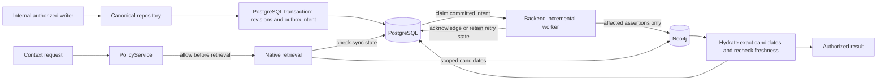
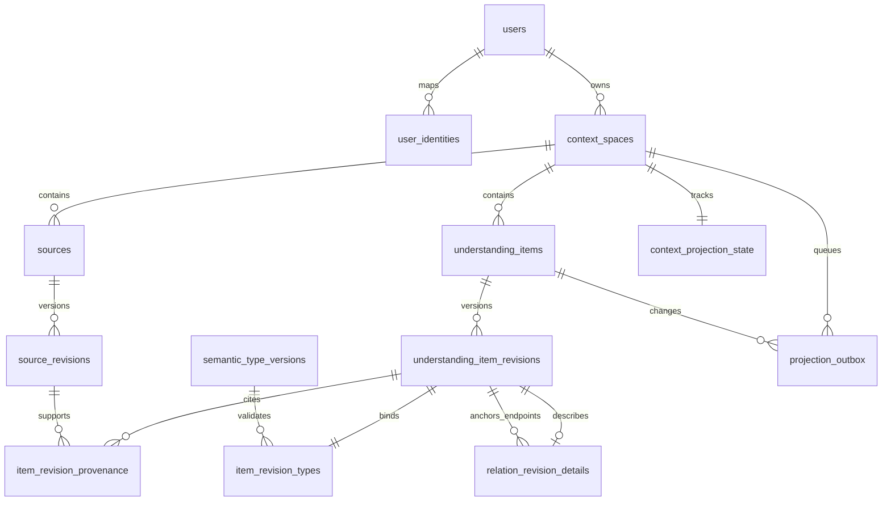
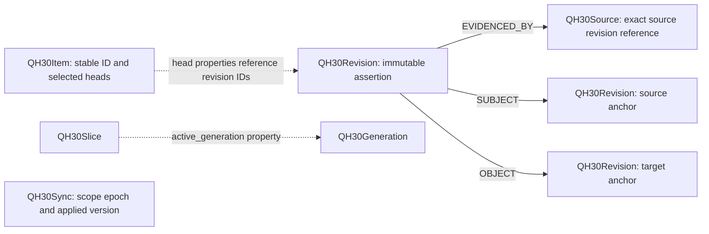

# QH

QH is a sovereign context platform: people preserve, query, govern and selectively
share persistent understanding through Context Spaces, independently of AI providers.
Stable identity, immutable revisions, explicit validation and traceable evidence keep
interpretations distinct from their sources and substantial decisions human-controlled.
A space can contain multiple domains without a separate schema for each.

## Implementation status

| Layer | State |
| --- | --- |
| Foundation on `main` | Docker scaffold, Core/application contracts, QH-4 PostgreSQL foundation, QH-5 OIDC identity and owner PolicyService |
| QH environment | Schema 0004; native backend/worker active at `fd50b1b`. Persistent synthetic smoke and controlled backend restart passed; Graphiti data retained |
| QH-30 branch | Native canonical repository, 0003 semantic model, 0004 outbox, backend lifespan/worker and authorized retrieval implemented and tested on isolated real databases |
| Separate cleanup branch | Controlled generic profiles, exact descriptor selection and prepared 0005; not pushed, deployed or authorized for persistent application. [Foundation and audit closure](docs/qh-semantic-consolidation.md) |
| Future | Source Vault (QH-31), Domain Packs, native Mistral extraction/resolution, embedding cache and advanced vector/hybrid retrieval; product context operations through MCP |

Graphiti is a preserved historical prototype, not a native-engine dependency.
The independent MCP server currently provides transport scaffolding, not a QH context
client. Current deployed native text search uses scoped substring matching. This separate
branch also implements an internal exact descriptor selector: authorize → canonical
IDs from SQL → Neo4j verification → canonical hydration and freshness recheck.
Its design is approved; persistent provisioning/deployment remain gated. No public DTO changes or semantic ranking are implied.

## Architecture and data flow

The diagram describes the implemented QH-30 path, tested in isolation and activated
on the VPS at the pinned cutover commit. The worker
runs in the backend process; no broker or new microservice is required. Core stays
independent of FastAPI, database drivers and provider SDKs.

Canonical publication and projection intent commit atomically. Leases, per-space
sequences and epochs make retries idempotent and fence stale workers. Pending,
failed or mismatched projection state blocks retrieval, including empty results.
Queries do not require full reconciliation. Explicit rebuild/audit remains available;
normal readiness checks do not certify arbitrary manual graph corruption.

## PostgreSQL model through 0004

This simplified ERD describes schema **0004**, also deployed on the VPS. The
prepared 0005 cleanup is separate and does not add tables. Composite foreign keys enforce matching space and stable-ID/revision
anchors. Revisions, provenance, type schemas and semantic rules are immutable;
unknown fact/validity times stay null and are separate from acquisition metadata.

0003 adds three canonical tables: `semantic_type_versions`, `item_revision_types`
(type binding and universal temporal bounds), `relation_revision_details` (universal
item endpoints). No entity marker table is needed. 0004 adds two reconstructible
operational tables: `projection_outbox` and `context_projection_state`. The outbox
also references exact revisions where applicable. See [SQL details](docs/postgres-schema.md).

## Neo4j operational graph

Actual labels and assertion edges in the native adapters:

Dotted lines explain properties, not additional Cypher relationship types.
Relation endpoints can reference any registered item shape. PostgreSQL remains the
semantic and authorization authority; Neo4j retains operational assertions, evidence
references and synchronization markers. Rebuild uses canonical data without LLM calls.
Original-byte storage and access policy belong to future QH-31, not this graph.

## Development and verification

Use Docker Engine and Compose v2; dependencies install from committed lockfiles
inside images. Keep credentials in ignored local `.env`, never in Git or logs.
For a new local checkout, generate configuration with `python3 scripts/init_env.py`;
inspect the selected worktree/configuration before starting services.

- `make config`: validate Compose without printing credentials.
- `make up`: build/start the development stack; use only when container changes are authorized.
- `make verify-running`: verify an existing stack without rebuilding/replacing containers.
- `make verify`: build/start plus existing quality checks; not proof of dedicated QH-30 integration coverage.
- `make migrate`: **Alembic `upgrade head` against the configured database**. This command is not authorization to migrate persistent QH. A cutover must use the explicitly approved target/commit and configuration.

API startup does not migrate. Preserve database volumes; never add volume deletion
as routine cleanup. Do not point isolated tests at persistent QH. Dedicated QH-30
server names, opt-in variables, executed results, reproduction commands and the
strict integration CI job are in the [QH-30 checkpoint](docs/qh-30-plan.md).
The new `native-integration` job runs the strict disposable SQL/Neo4j suite and
fails on skips. Hosted run [38736085229](https://github.com/bl000m/qh/actions/runs/38736085229)
passed 178 native tests at `eeadeef`; this cleanup branch needs a separately authorized
push and new hosted execution. A green
quality/OIDC gate alone does not establish integrated coverage. Native runtime is
opt-in through `QH_NATIVE_CONTEXT_ENABLED`; the deployed image requires 0004. This
branch also accepts prepared 0005; startup never migrates.
The QH-30 checkpoint retains the executed 0004 cutover. The separate
[0005 activation runbook](docs/qh-semantic-consolidation.md#deployment-0004--0005--prepared-not-authorizedexecuted)
requires new authorization.

## Modules and technical references

| Path / reference | Responsibility |
| --- | --- |
| `apps/api/app/core`, `app/policy` | SDK-free contracts and owner authorization |
| `apps/api/adapters/postgres` | Canonical repository and additive migrations |
| `apps/api/adapters/context` | Native graph projection, incremental worker and retrieval |
| `apps/web`, `services/mcp-server`, `packages/shared` | Web scaffold, independent MCP transport, public wire types |
| [Product Contract](docs/product/QH_PRODUCT_CONTRACT.md) | Mandatory functional invariants |
| [CHANGELOG](CHANGELOG.md), [versioning and milestones](docs/versioning.md), [deployments](docs/deployments.md) | Unreleased changes, release discipline and executed/candidate artifact history |
| [Architecture](docs/architecture.md), [ADR 0003](docs/adr/0003-native-context-engine.md) | Boundaries, decision succession and native-engine approval gates |
| [AGENTS](AGENTS.md), [ticket skill](.agents/skills/jira-ticket-workflow/SKILL.md) | Development, authorization and evidence rules |
| [OIDC setup](docs/qh-5-authentication.md), [adapter notes](apps/api/adapters/README.md) | Detailed setup and internal integration boundaries |

Earlier `docs/verification-*` reports retain dated evidence, not current deployment
inventories. [Cutover evidence](docs/qh-30-plan.md#persistent-cutover-execution-and-read-only-historical-inventory)
records the active image, synthetic IDs and Graphiti integrity. Extraction, embedding
and advanced semantic retrieval remain future work; no further deployment is implicit.
