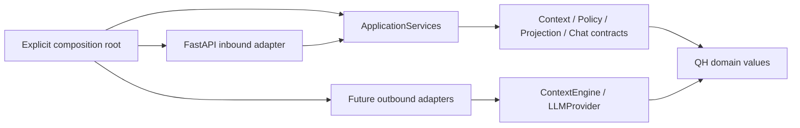

# ADR 0001 — QH Ports & Adapters

Date: 2026-10-13

Status: Accepted

Scope: [QH-2](https://contextlab.atlassian.net/browse/QH-2)

## Context

The QH-1 scaffold and QH-3 Compose base work. Context engines and LLM providers
must be replaceable without importing their SDKs or transport frameworks into
QH Core. This ticket defines boundaries before application behavior is built.

## Decision

Use immutable, keyword-only Python dataclasses, tuples and QH identifiers.
Keep domain types and asynchronous structural Protocols independent of FastAPI,
Graphiti, Neo4j, MCP and provider SDKs. No generic repository or DI container.

| Contract | Location | Responsibility |
| --- | --- | --- |
| ContextEngine.search(ContextQuery) → ContextResult | core/ports.py | Outbound context retrieval; SDK/graph data translated by adapters |
| LLMProvider.generate(GenerationRequest) → GenerationResult | core/ports.py | Outbound generation using QH messages only |
| ContextService.retrieve(ContextRequest) → ContextResult | core/services.py | Future authorized retrieval coordinating policy and engine |
| PolicyService.evaluate(PolicyRequest) → PolicyDecision | policy/services.py | Future subject/action/context access decisions |
| ProjectionService.project(ProjectionRequest) → ContextProjection | projections/services.py | Future presentation of already-authorized records with source IDs |
| ChatService.respond(ChatRequest) → ChatResponse | chat/services.py | Future coordination of policy, context, projections and provider |

Locations above are relative to `apps/api/app`. These are contracts only;
no policy enforcement, retrieval, formatting or chat business logic is supplied.
Future ContextService use cases belong outside Core and implement its contract.

## Dependencies and composition

Core imports only its own modules and the allowlisted standard library. Policy
and projections depend on Core and their own types; chat may additionally depend
on policy/projection contracts. Inner modules never import concrete adapters or
inbound API modules. Framework and provider dependencies point inward to QH.

`app/main.py:create_app(services=...)` explicitly receives immutable
ApplicationServices bindings. Implementations receive engine/provider clients
through constructors; there is no discovery, service registry or production fake.
The health-only scaffold permits services=None; future business routes must
require bindings. FastAPI routes are isolated in `app/api`.

Reserve `apps/api/adapters/context` and `adapters/llm` for outbound implementations
that translate SDK values to QH models. Graphiti will be a backend Python library,
never a sixth container. The independent MCP service stays a transport adapter
with no backend source imports or DB access; future integration needs a defined
service boundary. Frontend wire contracts remain separate in packages/shared.

## Verification and consequences

Tests exercise unrelated fake adapters, service signatures, returned QH values
and explicit HTTP bindings. Runtime-checkable Protocols check shape only; tests
also inspect annotations and exercise behavior. AST checks resolve relative and
type-only imports, reject outward dependencies and dynamic imports; python -I -S
imports the inner contracts without site packages. Existing service smoke checks
remain the regression suite. See [results](../verification-qh-2.md).

Domain values are not API DTOs; validation and transport conversion stay outside
Core. Production services, authorization rules, provider error mapping, richer
queries, streaming and concrete adapters are deferred. Use targeted tests per
commit and make verify-running for final integration without replacing containers.
