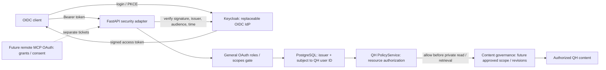

# QH architecture

Read the [QH Product Contract](product/QH_PRODUCT_CONTRACT.md) before decisions
about the domain or persistence. It is the functional reference; this document
and ADRs describe technical boundaries. Conflicts require STOP AND ASK, not
inference from existing code. [ADR 0002](adr/0002-canonical-understanding-persistence.md)
records the approved V0.1 model: PostgreSQL holds canonical sources, understanding,
revisions and governance. [ADR 0003](adr/0003-native-context-engine.md), authorized
by QH-30, makes semantic entities/relations canonical there and Neo4j a rebuildable
operational Context Graph. Graphiti remains an archived prototype on its own branch. QH-4 supplies
schema and minimal contract corrections, without graph duplication or feature
workflows. Applying migrations to the QH application database still needs approval.

The repository contains the working QH-1 scaffold, the five-service Compose
environment from QH-3 and the QH-2 domain/application contracts. The native Context Engine is being introduced under QH-30; schema changes remain
pending owner review. Production business routes remain deferred except QH-5
identity and owner authorization. See
[ADR 0001](adr/0001-modular-architecture.md).

## Containers

| Service | Runtime | Responsibility | Network / host access |
| --- | --- | --- | --- |
| frontend | Node 22.14.0; React, TypeScript, Vite | Serve frontend in development | app; loopback 5173 |
| backend | Python 3.12.9; FastAPI | HTTP adapter; `/health`, OIDC `/auth/me`, Core owner policy | app + data; loopback 8000 |
| mcp | Python 3.12.9; official MCP SDK 1.12.4 | Independent Streamable HTTP transport; `/mcp`, `/health`, `scaffold_ping` | app; loopback 3001 |
| neo4j | Neo4j Community 5.26.5 | Rebuildable operational Context Graph (QH-30) | internal data only; no host ports |
| postgres | PostgreSQL 16.8 | Canonical QH persistence and external identity mapping | internal data only; no host ports |
| keycloak (optional profile `oidc`) | Keycloak 26.4.7; OIDC | Local authentication and general roles/scopes; independent persistent IdP volume | app only; loopback 8080 |

Compose service names are internal DNS names. The browser uses host loopback
URLs, not Docker service names. The backend resolves identities and owners in
PostgreSQL; it never applies migrations during startup. See
[QH-5 setup](qh-5-authentication.md) for the authorized local application activation.
Backend startup waits for PostgreSQL readiness and an authenticated Neo4j probe. MCP is
independent of backend startup and has no DB credentials or data network access.

## Module boundaries

### Identity and authorization (QH-5 / QH-29)

[Identity ADR](adr/0002-identity-and-authorization.md) records the approved
separation. Keycloak is optional local infrastructure; the five base services
remain unchanged. Internal QH identities are independent of external identities.

Both applicable gates must allow access. A general OAuth scope does not grant
access to another owner's Context Space. QH Core receives only QH domain IDs.
`GET /auth/me` is the stable identity endpoint; private owner probe routes are
test-only. Remote delegated MCP OAuth is outside QH-5.

QH-29 formalizes `PolicyService` as the one logical resource-decision point,
initially implemented by the backend's existing `OwnerPolicyService`, with
replaceability through explicit injection. Future REST (QH-9) and MCP (QH-24)
share that policy through the authenticated backend; MCP has no direct DB access,
duplicate owner rules or unverified-identity bypass. Default deny precedes private
reads, semantic retrieval and LLM disclosure. Authentication, resource decisions
and content governance are separate responsibilities: the owner READ_CONTEXT
gate is implemented, while granular projection/snapshot scope and revocation
remain QH-14–QH-22. The diagram's governance stage records that future boundary,
not a currently implemented filtering engine.

- `apps/web` imports public wire contracts only; no backend implementation imports.
- `apps/api/app/core` owns immutable Python domain values, ContextEngine and
  LLMProvider outbound Protocols and the ContextService inbound contract.
- ContextId names a Context Space. ContextSearchHit has distinct retrieval identity
  and optional canonical item revision plus source revision provenance. Queries
  require explicit nonempty space scope; Core must authorize it, not trust the
  caller-supplied IDs. ContextProjection carries exact item/source revision
  references and is a formatting contract, not an Approved Snapshot.
- `app/policy`, `app/projections` and `app/chat` own their request/result values
  and PolicyService, ProjectionService and ChatService Protocols. Responsibilities
  and method signatures are documented in ADR 0001. OwnerPolicyService implements
  the owner-only READ_CONTEXT gate; other actions fail closed.
- `app/composition.py` holds the explicitly supplied ApplicationServices bindings.
  `app/main.py:create_app(services=...)` composes the HTTP transport. Services are
  optional for the scaffold; authentication without bindings fails closed. The
  runtime factory `app/bootstrap.py:create_runtime_app` binds the OIDC verifier,
  PostgreSQL identity/owner reader and Core owner policy explicitly.
- `app/api` owns FastAPI routes. The only current business-independent route
  routes are `/health` and `/auth/me`. Private owner probe routes exist only in
  tests, and no access endpoint is installed in production.
- API, MCP and outbound adapters depend on Core interfaces. Core must never
  import FastAPI, Graphiti, MCP, adapters or provider SDKs. Composition roots
  assemble implementations through dependency injection.
- `apps/api/adapters/context` owns the native Neo4j projector/retriever behind
  ContextEngine (QH-30). PostgreSQL is authoritative; the graph is an operational
  projection, never a second canonical repository. `adapters/llm` reserves replaceable
  provider clients. Extractor/resolver/repository/projector/retriever responsibilities,
  synchronization, rebuild and approval boundaries are in ADR 0003. No production
  context binding, paid call, Graphiti runtime or new service is activated here.
- `services/mcp-server` owns its Python dependencies and transport. Future QH
  operations use a documented boundary; do not import backend source files.
  `scaffold_ping` is solely a transport test, with no context or LLM behavior.
- `packages/shared` is reserved for public schemas and TypeScript wire types;
  Python domain interfaces are not duplicated here.
- `infra/docker` owns networking, persistence and development orchestration.
- `apps/api/adapters/postgres` owns environment connection settings and Alembic
  revisions for canonical sources/items/provenance. No ORM enters Core and API
  startup never migrates. See [schema details](postgres-schema.md) for the seven
  foundation tables, immutability and atomic provenance assembly. QH-5 adds the
  unique issuer/subject mapping without changing those canonical tables. Projection,
  Snapshot and Share persistence is deferred to its feature tickets.

## Development and persistence

Application source bind mounts enable Vite and Uvicorn hot reload. Python uses
watchfiles polling and Vite polling for Docker on macOS. Dependencies remain
inside images, installed with `npm ci` or hash-locked `uv pip install`. Manifest
and lock changes require an image rebuild; source changes do not.

PostgreSQL and Neo4j data/log volumes survive `make down`. The `data` network
is internal and databases publish no ports. Only backend joins both app and
data networks. Frontend and MCP cannot connect directly to databases.
Credentials come from the root ignored `.env`, are not copied into builds, and
are never embedded in committed defaults. Changing passwords in `.env` does
not rotate credentials on initialized database volumes; use the database
administration workflow rather than deleting data.

Build, health and protocol results are recorded in `docs/verification-qh-1.md`.
QH-3's runtime isolation and database restart/persistence evidence are in
`docs/verification-qh-3.md`. `make verify-infra` checks five healthy services,
network and volume attachments, authenticated DB queries from backend and
denied TCP connections from frontend/MCP directly to both database IPs.
`make verify-persistence` additionally writes UUID-scoped markers, restarts only
existing DB containers, verifies the markers and removes only that probe's data.
Neither check deletes or replaces containers, images or volumes. Host Python
stdlib orchestrates Docker; database and TCP probes run in the containers.
These checks implement infrastructure verification, not application behavior.
This remains a local POC.

QH-2's AST tests enforce inward imports across all inner modules, and an isolated
Python subprocess imports their contracts without site packages. Contract tests
exercise fake adapters and explicit bindings. For an existing stack use
`make verify-running` to avoid replacing containers. QH-2 results and commit
history are recorded in `docs/verification-qh-2.md`; the approved baseline is
recorded in `docs/initial-commit-review.md`.

## Native Context Engine pivot (QH-30)

Source revision → authorized interpretation → validated canonical proposal/ACID
commit → idempotent operational graph projection → authorized retrieval and bulk
canonical hydration. See [ADR 0003](adr/0003-native-context-engine.md). Outbox,
embedding artifact cache and measurable projection progress are required when
incremental processing is introduced. The isolated full-snapshot reconciliation
currently uses no outbox; see its explicit O(n) trade-off in QH-30. No distributed transaction or automatic
re-extraction during rebuild. [QH-4 delta](qh-30-plan.md) is implemented/tested only in isolated migration 0003
and a real SQL-to-Neo4j slice; persistent application remains gated. Existing OIDC, PolicyService and public contracts remain unchanged.

### Universal semantic model (QH-30)

The native engine is independent of Context Space domain. Types and properties
are extensible through immutable versioned schemas; one space can mix domains.
Provenance, revisions, temporal meaning and validation belong to the universal
nucleus; PolicyService remains independent of semantic type. Domain Packs are a
future optional composition mechanism only. See ADR 0003 and the pending SQL
delta in [QH-30 plan](qh-30-plan.md); no migration or public DTO is approved here.
