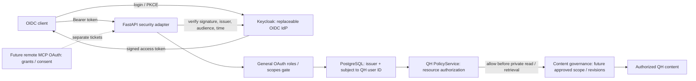
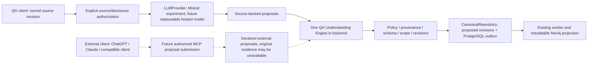

# QH architecture

Read the [QH Product Contract](product/QH_PRODUCT_CONTRACT.md) before decisions
about the domain or persistence. It is the functional reference; this document
and ADRs describe technical boundaries. Conflicts require STOP AND ASK, not
inference from existing code. [ADR 0002](adr/0002-canonical-understanding-persistence.md)
records the approved V0.1 model: PostgreSQL holds canonical sources, understanding,
revisions and governance. [ADR 0003](adr/0003-native-context-engine.md), authorized
by QH-30, makes semantic entities/relations canonical there and Neo4j a rebuildable
operational Context Graph. Graphiti remains an archived prototype on its own branch. QH-4 supplies
schema and minimal contract corrections, without graph duplication or feature
workflows. Further persistent migrations/deployment still need separate approval.

[Flexible Semantic Persistence and Context Graph Architecture](flexible-semantic-persistence.md)
explains the implemented SQL model through 0005, with an ER diagram, exact revision
anchors, generic profiles and open descriptors, independent validation/provenance/time
dimensions, and the internal authorized descriptor retrieval path. It distinguishes
implemented storage from planned collaboration, snapshot sharing and public retrieval;
it does not amend the Product Contract or ADRs.

The repository contains the working QH-1 scaffold, the five-service Compose
environment from QH-3 and the QH-2 domain/application contracts. The native Context Engine, approved semantic schema and incremental outbox are
consolidated in main and active on the VPS at schema 0005. The owner's later
2026-10-17 POC decision activates QH-12 frontend/backend from the single checkout
with Vite/Uvicorn hot reload, keeping project `qh`, loopback ports, native namespace,
worker, OIDC and policy. MCP remains image-only at c723d32; DB/IdP services and
volumes are unchanged. QH-9/10 business routes and QH-11/12 UI are active before
PR #13 merge. The prior frozen bundle is preserved for rollback; branch switches
now require stopping the two source-dependent apps. See
[operating procedure](qh-development-stack.md) and [deployment evidence](deployments.md).
No Core responsibility, public contract, canonical schema or provider policy changes.
See
[ADR 0001](adr/0001-modular-architecture.md).

## Product decisions and rationale

The owner-approved [ADR 0005](adr/0005-browse-first-context-understanding.md)
adds browse-first navigation of canonical understanding to QH-12, preserving
[Product Contract](product/QH_PRODUCT_CONTRACT.md#browse-first-understanding--owner-amendment-2026-10-17),
ADR 0003's PostgreSQL/derived graph separation and ADR 0004's governed proposal
inputs. Its decision matrix records rationale, alternatives, UX/architecture
consequences, limits and open questions. The new authenticated read-only GET
`/context-spaces/{id}/understanding` uses a distinct `ContextBrowse` value through
ContextService and the existing native service; it does not relax QH-10's search
selector. CanonicalRepository selects bounded owned IDs with filters before LIMIT;
Neo4j exact-ID verification, shared hydration, readiness and policy checks precede
disclosure. Empty selections also fail closed on unavailable/stale graph state.
No table, migration, new service, ownership rule or provider change.

The UI previews literal existing excerpts, current heads and proposals separately;
page-local descriptor groups are not global counts or a taxonomy. Readable cards
lead to reused canonical revision detail and exact history/relation navigation.
Search is secondary. Canonical-summary selection, LLM synthesis, editing/human
validation and advanced graph navigation remain outside this increment. See
[verifiable QH-12 criteria](qh-12-context-understanding.md#owner-approved-acceptance-criteria).

### Later Demo A interaction direction — planning only

The owner's [later Product Contract amendment](product/QH_PRODUCT_CONTRACT.md#demo-a-experience--owner-amendment-2026-10-17)
sets chat-first in-Space interaction for the next UX increment, with a visible,
expandable explorer and no mandatory query before access to understanding.
Earlier ADR 0005/0006 decisions and the current exploration-first implementation
remain historical/implemented checkpoints. Login-to-environment, refinement of the existing multi-Space overview
and supplied branding are future client work, not a new Domain model or OIDC system.
The [operational roadmap/seed plan](qh-13-demo-a-plan.md) separates QH-13 ephemeral
chat, explicitly authorized synthetic import and QH-39 conversational acquisition.
No change to Engine, canonical schema, public API, provider gate or runtime follows.

## Current code and planned product flows — 2026-10-17

QH-8, QH-32 and QH-33 are merged into `main`; QH-33's technical scope is DONE via
[PR #8](https://github.com/bl000m/qh/pull/8), merge
`a7a2da3e43fca3fbcd54dd743956c14e0fa599e2`. Its benchmark v2, provisional metrics,
offline comparisons and temporal validation correction are available in source,
**not activated on the VPS**. The deployed application images still come from
`c723d32c5d0825f9232ece560e7e666e69dceb27`, schema 0005. QH-38 remains open for
independent human validation of all 74 units; `human_review.metrics` stays null.
See the [closure record](qh33-closure-scope.it.md) and [deployment register](deployments.md).

The following roadmap reflects existing Jira scope, not new architecture or
implemented public contracts. The Product Contract and ADRs 0003/0004 above remain
authoritative; PostgreSQL is canonical and Neo4j derived.

| Planned flow | Reused responsibility / acceptance boundary |
| --- | --- |
| Demo A — QH-9–12 | ContextService/owner policy, scoped REST retrieval and React views; synthetic pipeline data is sufficient. Show structural shape, open optional descriptors/assignment certainty, canonical revision, validation, time and provenance separately; no closed category vocabulary or frontend re-extraction |
| QH chat — QH-13, then conversational update QH-39 | ChatService reuses retrieval and LLMProvider. QH-39 separately acquires an authorized SourceRevision and routes extraction through the existing QH-8/QH-32 Engine into atomic proposed revisions/outbox. No canonical write from an unvalidated chat answer or automatic confirmation |
| Demo B — QH-40, QH-14–16 and QH-18–22 | Manual Projection Editor → authorized preview → immutable Approved Snapshot → expiring/revocable guest link. Natural-language scope suggestion QH-17 is optional, not a dependency of the manual editor; MCP is not required |
| Complete demo / Demo C — QH-26 with QH-23–25 | Reuse verified guest flow, add MCP discovery/preview/retrieve and cross-channel access checks through the authenticated backend. MCP has no backend imports or direct DB access; external proposal submission QH-34 remains a separate future ingress |

Snapshot approval authorizes sharing; it does not promote an item's epistemic
state to `confirmed`. Guest retrieval and optional generative questions are limited
to the materialized authorized snapshot revisions, never the live source Space or
an unrestricted graph query. Later Space updates cannot broaden the snapshot.
Demo B can start with verified synthetic data; a live chat-to-understanding claim
requires QH-39. Disclosure policy and separately authorized provider cost limits
apply before inference. None of these roadmap entries grants deployment or write
permission or certifies general semantic correctness.

## Containers

| Service | Runtime | Responsibility | Network / host access |
| --- | --- | --- | --- |
| frontend | Node 22.14.0; React, TypeScript, Vite | Serve frontend in development | app; loopback 5173 |
| backend | Python 3.12.9; FastAPI | HTTP adapter; `/health`, OIDC `/auth/me`, Core owner policy | app + data; loopback 8000 |
| mcp | Python 3.12.9; official MCP SDK 1.12.4 | Independent Streamable HTTP transport; `/mcp`, `/health`, `scaffold_ping` | app; loopback 3001 |
| neo4j | Neo4j Community 5.26.5 | Rebuildable operational Context Graph (QH-30) | internal data only; no host ports |
| postgres | PostgreSQL 16.8 | Canonical QH persistence and external identity mapping | internal data only; no host ports |
| keycloak (optional profile `oidc`) | Keycloak 26.4.7; OIDC | Local authentication and general roles/scopes; independent persistent IdP volume | app only; loopback 8080 |

Compose service names are internal DNS names. The browser uses host loopback
URLs, not Docker service names. The backend resolves identities and owners in
PostgreSQL; it never applies migrations during startup. See
[QH-5 setup](qh-5-authentication.md) for the authorized local application activation.
Backend startup waits for PostgreSQL readiness and an authenticated Neo4j probe. MCP is
independent of backend startup and has no DB credentials or data network access.

## Module boundaries

### QH-12 structured understanding view (unmerged, active in authorized development POC)

The existing browser detail composes the QH-11 metadata view with read-only QH-10
canonical retrieval. Navigation names one authorized Space and an explicit
current/proposed/history view. Complementary QH-10 search additionally requires
exactly one approved text/descriptor selector.
The later browse-first amendment adds a real no-selector GET; QH-10 POST remains
selector-based. No empty query, wildcard or fixed meaning vocabulary is introduced. Unclassified items remain searchable by text. Cursor pagination
uses the backend's view-filtered pages; no frontend visibility filtering.

Rendering preserves structural shape, open assignments/certainty, epistemic
state, immutable revision identity, relation endpoint anchors, fact/validity
bounds and source-revision provenance separately. Only recognizable QH-8 locator
payloads are displayed as literal quotations; arbitrary historical citation
properties and nonconforming historical descriptor objects remain unmodified JSON. Source bodies are not invented/fetched through
a new API; matching quotations are not a semantic-validity assertion. A failed
request/freshness check discards visible pages and displays unavailable, not empty.
No editing, confirmation, new policy, schema, service or browser session is added.

### QH-11 browser client (merged, active in authorized development POC)

The existing React 18/TypeScript/Vite client owns browser navigation and Space
metadata views only. Its HTTP client uses QH-9 public REST contracts through the
same-origin `/api` development proxy. The backend still resolves OIDC identity
and enforces the shared PolicyService before private reads; UI filtering grants
no access. No Understanding view, session backend, table or service is added.

Owner-approved browser session choice (2026-10-17): public `qh-web` Authorization
Code + PKCE S256 via `oidc-client-ts`, with a nonce and one-use state validation.
Tokens remain in memory; only pending authentication state/verifier use tab-scoped
sessionStorage, with a five-minute stale-state limit. No localStorage token,
automatic renewal or password grant. Reload requires login again (IdP SSO may
satisfy it); token expiry/HTTP 401 removes the private UI. Logout first clears QH
memory, then invokes OIDC end-session without expanding the realm redirect list.
An unavailable IdP cannot prevent local logout; remote logout may then be incomplete.
This bounded SPA choice adds no BFF or persistent session contract.

### QH-10 canonical Understanding retrieval (merged, not deployed)

QH-10 extends the same ContextService with structured, owner-authorized retrieval
through the existing native ContextEngine; SQL selection, graph verification and
canonical hydration stay in outbound adapters. `POST /context-spaces/query` adds
no generation or new engine. The owner explicitly approved mandatory
`view=current|proposed|history`, where history retains all revisions with explicit
state/current markers, pagination after visibility filtering, and temporal metadata
without temporal/as-of filtering. No validation or sharing permission is added.

See [QH-10 REST contract and evidence](qh-10-scoped-retrieval.md). Core values
carry canonical revision content and exact source references; public DTOs contain
no SQLAlchemy, graph-driver or provider objects. Per-request freshness spans the
final hydration; the shared policy is checked again before returning even an
empty result. Physical relation anchors are verified for structured results.

### QH-9 Context Space management (merged, not deployed)

`app/context` implements the Core ContextService management operations, depending
only on Core repository/value contracts and the existing PolicyService. Core keeps
its retrieval signature; QH-9 exposes no Understanding retrieval. The PostgreSQL
adapter manages existing Space metadata; FastAPI validates wire inputs and uses
the authenticated internal subject. Bootstrap supplies the same policy instance
to security and service bindings. Create/list authorize the authenticated subject's
own namespace; read/rename authorize owner access before metadata lookup. There
are no sharing grants, owner transfers or deletion lifecycle in this increment.
No schema change, second identity system, graph dependency or runtime deployment.

### Identity and authorization (QH-5 / QH-29)

[Identity ADR](adr/0002-identity-and-authorization.md) records the approved
separation. Keycloak is optional local infrastructure; the five base services
remain unchanged. Internal QH identities are independent of external identities.

Both applicable gates must allow access. A general OAuth scope does not grant
access to another owner's Context Space. QH Core receives only QH domain IDs.
`GET /auth/me` is the stable identity endpoint; private owner probe routes are
test-only. Remote delegated MCP OAuth is outside QH-5.

QH-29 formalizes `PolicyService` as the one logical resource-decision point,
initially implemented by the backend's existing `OwnerPolicyService`, with
replaceability through explicit injection. Merged metadata REST (QH-9), merged
canonical retrieval (QH-10) and future MCP (QH-24)
share that policy through the authenticated backend; MCP has no direct DB access,
duplicate owner rules or unverified-identity bypass. Default deny precedes private
reads, semantic retrieval and LLM disclosure. Authentication, resource decisions
and content governance are separate responsibilities: the owner READ_CONTEXT
gate is implemented, while granular projection/snapshot scope and revocation
remain QH-14–QH-22. The diagram's governance stage records that future boundary,
not a currently implemented filtering engine.

- `apps/web` imports public wire contracts only; no backend implementation imports.
- `apps/api/app/core` owns immutable Python domain values, ContextEngine and
  LLMProvider outbound Protocols and the ContextService inbound contract.
- ContextId names a Context Space. ContextSearchHit has distinct retrieval identity
  and optional canonical item revision plus source revision provenance. Queries
  require explicit nonempty space scope; Core must authorize it, not trust the
  caller-supplied IDs. ContextProjection carries exact item/source revision
  references and is a formatting contract, not an Approved Snapshot.
- `app/policy`, `app/projections` and `app/chat` own their request/result values
  and PolicyService, ProjectionService and ChatService Protocols. Responsibilities
  and method signatures are documented in ADR 0001. OwnerPolicyService implements
  owner READ_CONTEXT and QH-9's own-namespace create/list/name-update actions;
  unrelated actions still fail closed. Projection/chat remain unbound in QH-9.
- `app/composition.py` holds the explicitly supplied ApplicationServices bindings.
  `app/main.py:create_app(services=...)` composes the HTTP transport. Services are
  optional for the scaffold; authentication without bindings fails closed. The
  runtime factory `app/bootstrap.py:create_runtime_app` binds the OIDC verifier,
  PostgreSQL identity/owner reader and Core owner policy explicitly.
- `app/api` owns FastAPI routes. `/health` and `/auth/me` remain available; the
  QH-9 adds `/context-spaces` POST/GET and UUID detail GET/PATCH-name;
  the QH-10 candidate adds `POST /context-spaces/query` for structured retrieval.
  Private owner probes remain test-only; no `/access` or generative `ask`
  endpoint is installed. See [QH-9 evidence](qh-9-context-spaces.md) and the
  [QH-10 query contract](qh-10-scoped-retrieval.md). Neither increment is deployed.
- API, MCP and outbound adapters depend on Core interfaces. Core must never
  import FastAPI, Graphiti, MCP, adapters or provider SDKs. Composition roots
  assemble implementations through dependency injection.
- `apps/api/adapters/context` owns the native Neo4j projector/retriever behind
  ContextEngine (QH-30). PostgreSQL is authoritative; the graph is an operational
  projection, never a second canonical repository. `adapters/llm` owns replaceable
  provider clients. Extractor/resolver/repository/projector/retriever responsibilities,
  synchronization, rebuild and approval boundaries are in ADR 0003. Native runtime
  and incremental worker are bound by the backend lifespan. QH-8's optional Mistral
  adapter/manual experiment and offline extraction are merged internal composition
  (see below), not startup behavior or a released conversational write route.
  QH-9 binds metadata CRUD; the QH-10 candidate binds canonical retrieval through
  that runtime. Chat remains QH-13.
- `services/mcp-server` owns its Python dependencies and transport. Future QH
  operations use a documented boundary; do not import backend source files.
  `scaffold_ping` is solely a transport test, with no context or LLM behavior.
- `packages/shared` is reserved for public schemas and TypeScript wire types;
  Python domain interfaces are not duplicated here.
- `infra/docker` owns networking, persistence and development orchestration.
- `apps/api/adapters/postgres` owns environment connection settings and Alembic
  revisions for canonical sources/items/provenance. No ORM enters Core and API
  startup never migrates. See [schema details](postgres-schema.md) for the seven
  foundation tables, immutability and atomic provenance assembly. QH-5 adds the
  unique issuer/subject mapping without changing those canonical tables. Projection,
  Snapshot and Share persistence is deferred to its feature tickets.

## Development and persistence

Application source bind mounts enable Vite and Uvicorn hot reload. Python uses
watchfiles polling and Vite polling for Docker on macOS. Dependencies remain
inside images, installed with `npm ci` or hash-locked `uv pip install`. Manifest
and lock changes require an image rebuild; source changes do not.

PostgreSQL and Neo4j data/log volumes survive `make down`. The `data` network
is internal and databases publish no ports. Only backend joins both app and
data networks. Frontend and MCP cannot connect directly to databases.
Credentials come from the root ignored `.env`, are not copied into builds, and
are never embedded in committed defaults. Changing passwords in `.env` does
not rotate credentials on initialized database volumes; use the database
administration workflow rather than deleting data.

Build, health and protocol results are recorded in `docs/verification-qh-1.md`.
QH-3's runtime isolation and database restart/persistence evidence are in
`docs/verification-qh-3.md`. `make verify-infra` checks five healthy services,
network and volume attachments, authenticated DB queries from backend and
denied TCP connections from frontend/MCP directly to both database IPs.
`make verify-persistence` additionally writes UUID-scoped markers, restarts only
existing DB containers, verifies the markers and removes only that probe's data.
Neither check deletes or replaces containers, images or volumes. Host Python
stdlib orchestrates Docker; database and TCP probes run in the containers.
These checks implement infrastructure verification, not application behavior.
This remains a local POC.

QH-2's AST tests enforce inward imports across all inner modules, and an isolated
Python subprocess imports their contracts without site packages. Contract tests
exercise fake adapters and explicit bindings. For an existing stack use
`make verify-running` to avoid replacing containers. QH-2 results and commit
history are recorded in `docs/verification-qh-2.md`; the approved baseline is
recorded in `docs/initial-commit-review.md`.

## Native Context Engine pivot (QH-30)

Source revision → authorized interpretation → validated canonical proposal/ACID
commit → idempotent operational graph projection → authorized retrieval and bulk
canonical hydration. See [ADR 0003](adr/0003-native-context-engine.md). Versioned embedding artifact caching remains future work. Migration 0004 now implements transactional
outbox/state with a backend-local incremental worker, verified and deployed; full-snapshot
reconciliation is explicit recovery, not an ordinary query prerequisite. No distributed transaction or automatic
re-extraction during rebuild. [QH-4 delta and cutover](qh-30-plan.md) record migrations 0003/0004, real SQL-to-Neo4j
tests and their authorized persistent activation. Existing OIDC, PolicyService and public contracts remain unchanged.

### Universal semantic model (QH-30)

The native engine is independent of Context Space domain. Types and properties
are extensible through immutable versioned schemas; one space can mix domains.
Provenance, revisions, temporal meaning and validation belong to the universal
nucleus; PolicyService remains independent of semantic type. Domain Packs are a
future optional composition mechanism only. See ADR 0003 and the approved SQL model/evidence in [QH-30 plan](qh-30-plan.md).
Further persistent migrations, backend changes and public DTO changes remain gated.
The [post-cutover foundation](qh-semantic-consolidation.md) implements the approved
three-generic-profile direction, controlled provisioning and an internal authorized
exact descriptor selector. The owner approved the profiles and open descriptor contract; persistent activation succeeded through the owner-authorized final consolidation. Meaning stays in extensible content;
shape selects storage constraints. Applied 0005 removes null legacy category
metadata without rewriting historical types/bindings. The generic profiles and
internal selector are active; source changes in the permanent main checkout do
not change deployed application images. QH-31 Source Vault, Domain Packs and
advanced vector retrieval remain future work; QH-8 extraction is merged internal
code, not a deployed conversational feature. Ordinary native queries use
per-scope sync state and candidate hydration; `ProjectionWorker.rebuild` is explicit recovery.
The separate snapshot reconciler and full-scope query scans have been retired from the active implementation;
its generation publisher remains necessary for rebuild.

## QH-8 internal extraction boundary

`app/understanding` owns conversational import, provider-neutral output validation,
exact Unicode citations and conservative local-reference resolution. It calls the
existing LLMProvider and injected CanonicalRepository; Core/public DTOs are unchanged.
`adapters/llm/offline.py` supplies explicit fixture and captured-response replay
implementations, never auto-bound at startup. The trusted internal caller needs
separate import/extraction authorization; the existing owner READ_CONTEXT check is
an additional read gate, not a new write or external-provider disclosure grant.
Sources commit before generation; validated proposed revisions/evidence commit as
one batch through the existing SQL outbox. No provider transaction or direct graph
write is introduced. Checkpoints are revalidated against immutable source revisions;
replay never changes current/confirmation. This feature is not deployed on the VPS.

## One QH Understanding Engine — approved 2026-10-16

[ADR 0004](adr/0004-unified-understanding-engine.md) refines ADR 0003: the existing
backend owns one provider-agnostic Understanding Engine that validates, conservatively
reconciles and persists proposals. It is not another service or a second canonical
graph. Two input channels converge on its existing governance/publication path:

Solid edges describe the trusted internal QH-8 experiment plus this resolver
increment, not a released conversation UI or public write grant. Dotted edges
are the approved future input, not an implemented public interface.
QH-client extraction uses outbound `LLMProvider`; an external submission is an
inbound application contract owned by `app/understanding`, documented in ADR 0004
and distinct from generation. It need not carry the entire external conversation
or require another inference. Independent MCP remains transport-only with no
backend imports or DB access; no MCP tool/HTTP DTO is implemented here.

Source-backed citations can be verified only against an available, authorized
original revision. Externally declared proposals without that evidence must retain
the weaker declared provenance; authenticated submission does not establish original
source support. The current strict QH-8 evidence requirement is not relaxed to accept
such submissions. All AI proposals remain proposed; no automatic confirmation,
identity merge, new permission or cross-space disclosure follows from either channel.

`app/understanding/citations.py` owns deterministic exact-quote location for an
explicit derivation before strict QH-8 validation. The original capture and derived
checkpoint are separate, with hashes and locator audit. Unsupported/ambiguous evidence
rejects the whole batch; source access is authorized before resolution. This does
not repair semantic errors, replace canonical SQL validation, change the live provider
or introduce partial publication. Native reconciliation/rebuild remains the QH-30
responsibility; semantic reconciliation and candidate staging remain future work.

## QH-33 offline evaluation boundary

QH-33's technical delivery is merged/DONE; independent human review is deferred
to QH-38, not silently replaced with a second AI assessment. No evaluation script
is a deployed semantic adjudicator or confirmation mechanism.

`scripts/evaluate_qh33.py` is offline benchmark/review tooling, outside canonical
publication and provider generation. It accounts for versioned, explicitly judged
propositions, verifies source/payload identities and emits pending review material.
It is not a semantic classifier, ontology or automatic approval gate. The existing
extractor's literal temporal-evidence check requires a whole timestamp occurrence,
not a prefix of another offset/token; this proves lexical support only. Unknown
bounds, proposed state, whole-batch publication and human governance remain intact.
The candidate prompt is documentary/opt-in future experiment input, not the live
default. See [QH-33](qh33-semantic-evaluation.md) for measured limits and review gates.

## Scoped contextual chat — QH-13

Owner-approved [ADR 0006](adr/0006-scoped-contextual-chat.md) implements the chat
path without a second Context Engine or LLMProvider contract. Authentication →
ChatService → separate single-Space CHAT policy → existing ContextService browse/
canonical and graph verification → pure bounded Context Builder → replaceable
LLMProvider. The default is an explicitly labelled offline extractive mock;
Mistral configuration remains separately authorized and disabled on the VPS.

Confirmed-current is default, proposals require explicit opt-in and keep their
state, canonical history is excluded. Browser-memory dialogue is untrusted and
not persisted. Generated responses never change Understanding State; QH-39 remains
separate. The service rechecks selection and policy before/after generation;
no transaction spans inference. Source records are data, not executable instructions.

The [QH-13 report](qh-13-contextual-chat.md) records bounded UUID enumeration,
input/output caps, partial coverage, reference-membership checks, paid-call gates
and the limits of semantic/prompt-injection guarantees. Browsing stays primary
under ADR 0005 in the current UI; the later owner amendment above changes future
interaction priority. Exact source identity is not proof of answer
entailment. Local-model substitution only changes the outbound adapter.

The [review correction checkpoint](qh-13-review-corrections.md) introduces a pure,
lossless internal `qh.chat.context/1` encoding: exact shared source records by
source-revision ID and identical administrative metadata are stored once, then
expanded into full canonical revision records. Content, validation state, temporal
assertions and relation anchors are preserved. Collision/scope/JSON checks fail
closed; existing canonical hydration, CHAT, selection freshness, whole-record
budgeting and public DTOs are unchanged. This reduces repeated bytes, not retrieval
semantics. The default mock UI explicitly says it does not understand the question.

The subsequent [model reference protocol](qh-13-reference-aliases.md) uses internal
context v2: deterministic request-local aliases over exactly the transmitted
revisions, strict bijection/response validation and exact resolution into unchanged
canonical citation DTOs. No item-ID repair, new port or public schema. Retained
records snapshot the sent data; existing live freshness checks still apply.
Deterministic French UI warnings derive proposed/confirmed information from those
verified DTOs, independently of generated prose. Identity/provenance/validation
are not semantic entailment; no new live inference or confirmation is implied.
