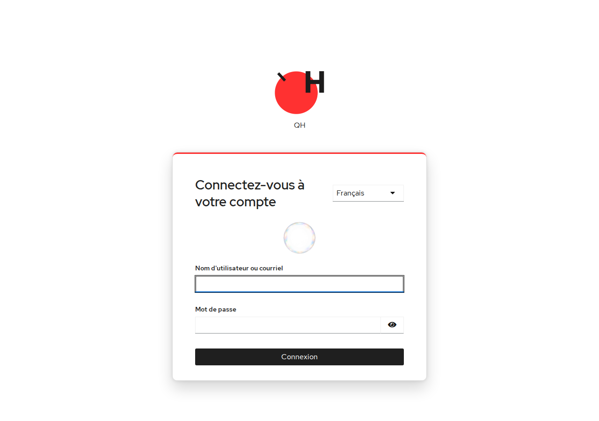
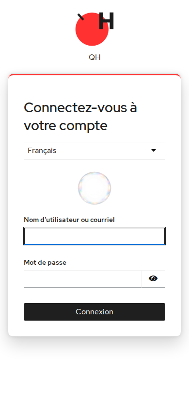
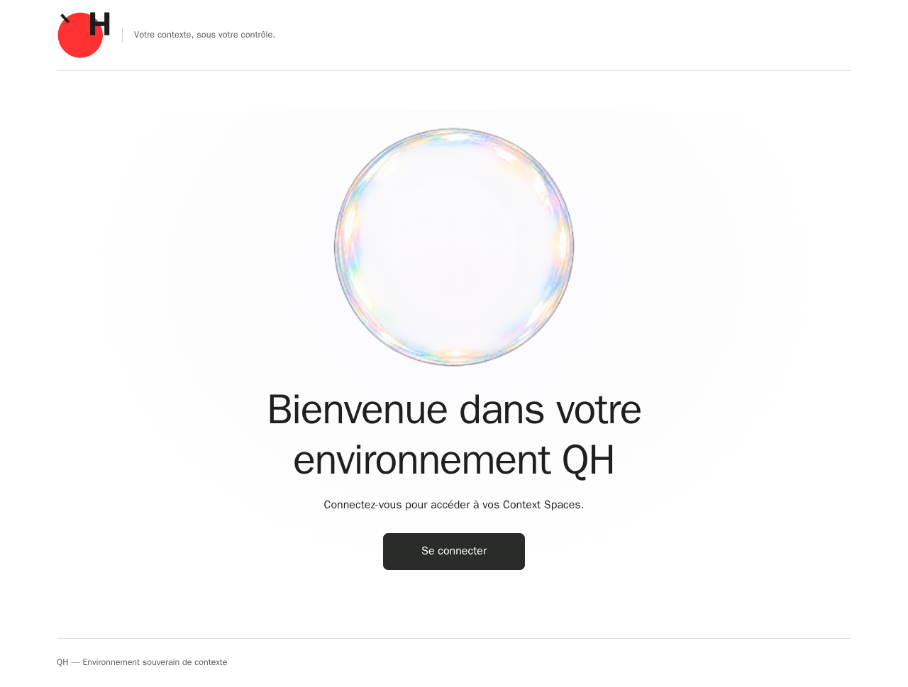
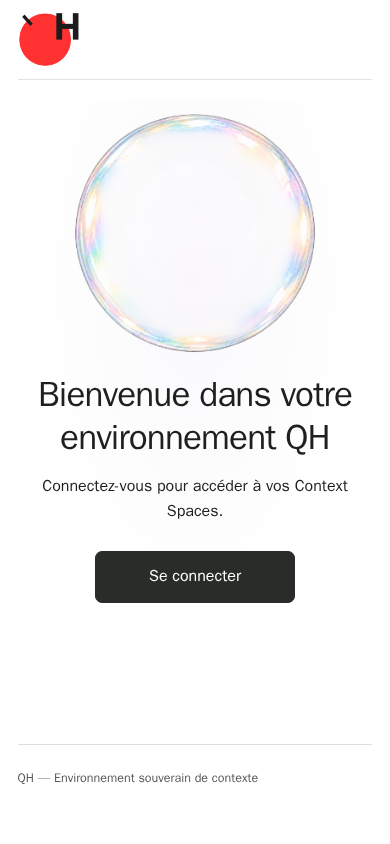

# QH-43 — final owner centering correction

2026-10-18 (Europe/Rome). Before the authorized merge, the owner accepts the UX
baseline with one final condition: the original bubble must be horizontally centred.
Baseline HEAD was exactly `b1d721a642a815d82493c7d1cb5ebe2608a91ebd`, mergeable
with all four hosted jobs green. This small correction necessarily adds a commit;
merge is conditional on the new HEAD checks, not the old green result.

The inherited Keycloak header used percentage columns plus a gap: the bubble
occupied only the heading column. It now spans the full grid, whose columns account
for the language selector and gap. Mobile welcome/environment also override the
earlier left alignment. No original image is cropped or changed. New browser
assertions measure horizontal centring at desktop/mobile widths and login grid width.

Only the existing installed theme CSS is replaced, with a frozen previous copy
available privately. No realm PUT, restart, recreation, Compose, volume or OIDC change.
Fresh actual VPS desktop/mobile logins as Alice pass; welcome/environment centre
within two CSS pixels and the login bubble spans the entire inner header. Historical
live-login evidence remains byte-identical and describes its original source revision.
Use this later audit for historical/current lineage rather than running the old
snapshot audit against changed CSS. The earlier 11 live security checks remain
applicable: this correction changes layout only. No QH or provider writes occur.

| Desktop | Mobile |
| --- | --- |
|  |  |
|  |  |

Results and source/theme hashes: [receipt](results.json). The six container
identities/configuration/start times, fourteen QH tables, private configuration,
readonly import, ledgers and original references remain equal to the preflight.
