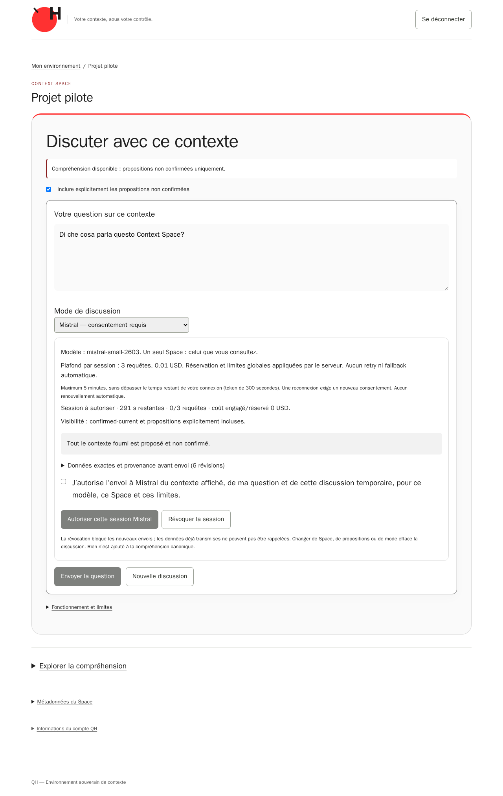
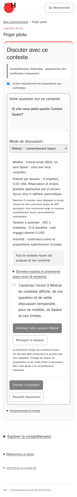

# QH-45 — implemented session consent, offline provider acceptance

2026-10-18 (Europe/Rome). Actual implemented frontend/API, exercised in the existing
**disposable** QH browser harness with real Keycloak/PKCE, PostgreSQL, Neo4j and
canonical records. Mistral HTTP is simulated with `httpx.MockTransport`. These are
not live Mistral answers, a paid experiment or evidence of semantic comprehension.
The VPS remains mock/session-disabled, separately checked read-only.

| Desktop | Mobile |
| --- | --- |
|  |  |

The mock is default. The question precedes provider selection on mobile. Mistral
selection alone sends nothing externally. Preview shows actual six proposed canonical
revisions, source provenance, exact supplier messages and a snapshot hash; proposal
inclusion and external disclosure are separate controls. Consent is initially
unchecked and the authorize/send controls are disabled until the required steps.
Timer/ceiling/model are server-bound. Responses retain the original canonical
citation/epistemic warning components; no persistent chat or confirmation is added.

## Executed evidence and reproducibility

- Initial full browser run: a real mobile composer-position regression was found;
  the provider control moved below the question without relaxing its existing
  <650 px assertion. The next full browser run had **55 PASS**. Its following
  OIDC check found the old exact OpenAPI allowlist; the approved five paths and
  methods were added explicitly, with no wildcard/dynamic-head acceptance.
- Latest local targeted run: **5 PASS** (real APIs with simulated Mistral, separate
  consent, exact preview, references, follow-up, question/Space reset, revocation,
  error/no-fallback, browser expiry and actual OIDC logout/revoke; mobile composer).
  The existing OIDC regression then passed **1 test**, graph-outage/control phase
  **4 tests**, and post-restore canonical browser phase **1 test**. Counts overlap
  other suites and are never summed into a fictional full run.
- The [underlying harness receipt](browser-receipt.json) retains its inherited
  `ticket=QH-12` label and exact image IDs. `qh45_http_simulated_sessions=true`
  identifies the QH-45 extension; the old harness was reused, not duplicated.
- Backup/restore equality and rebuild retain exact source/item IDs and source
  evidence. Only test-owned UUID databases/namespaces/containers are removed.
- [Actual VPS receipt](vps-readonly.json): Alice gets real-session capability
  disabled for all three retained synthetic Spaces, Bob gets three 404 denials;
  default mock answers with six proposed records. Selecting Mistral is unavailable
  and cannot send; no canonical/configuration/provider write or new key disclosure.
- Full native/targeted outcomes and preservation are in [results](results.json).
  Local runs belong to the recorded images; final exact-HEAD hosted CI is the
  authoritative check for the final serializers/response identity guards as well.

`manifest.json` seals the archive. `audit.py` verifies it, current implementation
source fingerprints, immutable original proposal wireframes and preservation/zero
paid-call assertions. Historical QH-8/QH-13/QH-33/QH-43 captures remain unchanged;
old source-bound snapshot audits must be run at their documented revisions.

See [implementation/Done mapping](../../qh-45-generative-chat.md),
[approved ADR](../../adr/0007-scoped-provider-sessions.md) and
[unexecuted first-session protocol](../../qh-45-provider-session-proposal.md).
No merge, Jira DONE, live session activation, new canonical model or inference is
part of this checkpoint. The first real session still requires a separately
approved exact manifest, disclosure/spend budget and backend configuration window.
