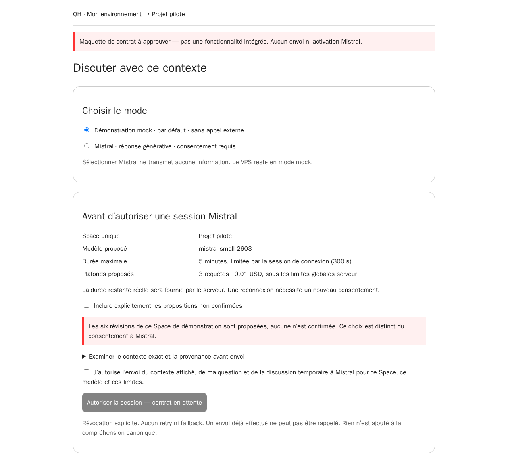
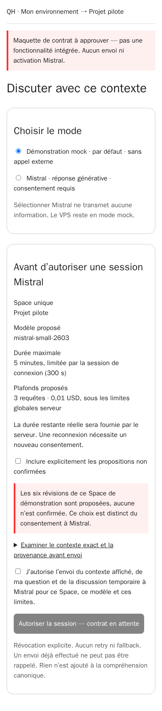

# QH-45 — contract-review wireframes, not implemented UI

2026-10-18 (Europe/Rome). These screenshots render the self-contained
[French consent wireframe](consent-preview.html) in Chromium with network disabled.
They show a proposal for provider selection and disclosure, **not** a working
QH frontend, session, permission, grant or Mistral activation. No image/model was
generated, no live data/provider was accessed. The final UI must use the existing
QH components, selected branding and trusted preview endpoint after contract approval.

| Desktop | Mobile |
| --- | --- |
|  |  |

Mock is selected by default. Proposal inclusion and external disclosure have
separate unchecked controls; the consent button is deliberately disabled. The
wireframe never supplies a fake canonical payload or countdown. Exact snapshot,
remaining token lifetime, cost reservation and availability must come from the
approved backend implementation, not from this HTML or browser assertions.

See the [session proposal and later real-test protocol](../../qh-45-provider-session-proposal.md).
