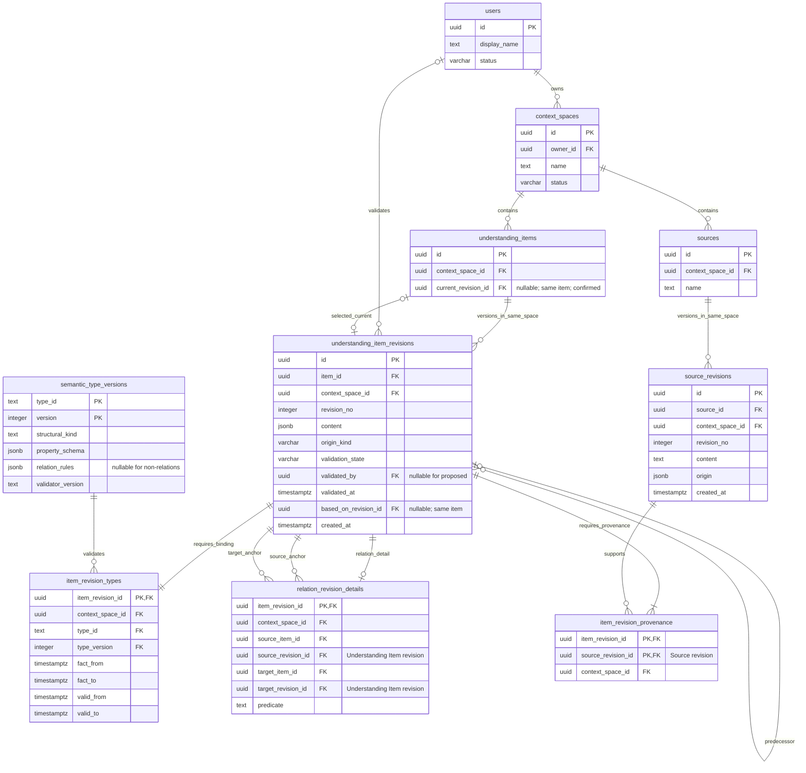

# QH — Flexible Semantic Persistence and Context Graph Architecture

2026-10-17. This is an implementation guide to the canonical model through schema
`0005_retire_legacy_category`, not a new architecture decision or migration proposal.
It accompanies [QH-9](qh-9-context-spaces.md) / [PR #10](https://github.com/bl000m/qh/pull/10).
The [Product Contract](product/QH_PRODUCT_CONTRACT.md),
[canonical persistence ADR 0002](adr/0002-canonical-understanding-persistence.md),
[identity ADR 0002](adr/0002-identity-and-authorization.md),
[ADR 0003](adr/0003-native-context-engine.md) and
[ADR 0004](adr/0004-unified-understanding-engine.md) remain authoritative.
Their dated amendments preserve the decision history; earlier category and
Graphiti descriptions are not the current storage discriminator or runtime.

## Capability and deployment boundaries

| Label | Meaning in this guide |
| --- | --- |
| **IMPLEMENTED** | Exists in repository code and the SQL model; not necessarily exposed publicly or deployed |
| **INTERNAL ONLY** | Implemented application/repository/runtime capability, without a public REST/MCP product contract |
| **PLANNED** | Approved direction or roadmap work; no claim of an implemented feature |

The VPS still runs backend/frontend/MCP images from
`c723d32c5d0825f9232ece560e7e666e69dceb27`, with PostgreSQL schema 0005 and the
three explicitly provisioned generic profiles. It has no application source bind
mounts. Later extraction, citation-resolution and semantic benchmark increments
are available in Git, not activated by merging code. QH-9 adds authenticated Space
metadata REST in this PR; its merge does not deploy those routes. See the
[deployment register](deployments.md) for exact executed and candidate artifacts.

## Architectural principles and independent dimensions

QH preserves an evolving state of understanding: supported observations, adopted
decisions, relevant hypotheses and uncertainty, and the revisions needed to
reconstruct how that understanding changed. Source text remains distinguishable
from interpretation. This is more than storing documents or vector chunks, and
does not mean every resolved historical doubt must remain active forever.
Current selection, retained history and semantic interpretation are different concerns.

**IMPLEMENTED:** PostgreSQL is the canonical authority for sources, Understanding
Items, immutable revisions, structural bindings, relations and provenance.
Neo4j is the derived operational **Context Graph**, populated by the backend's
transactional outbox/worker and rebuildable from canonical state without another
LLM extraction. There is no second editable semantic truth in the graph.
Neither graph readiness nor a schema-valid payload certifies semantic correctness.

| Dimension | Concrete representation | What it does not establish |
| --- | --- | --- |
| Stable identity | `understanding_items.id`, with one `context_space_id` | A fixed interpretation for all time |
| Revision identity | `understanding_item_revisions.id`, positive per-item `revision_no`, optional predecessor | Automatic supersession or confirmation |
| **Structural shape** | Registry `structural_kind`: `item`, `entity`, `relation` | Whether a claim means decision, hypothesis or constraint |
| **Registered profile** | Immutable `(type_id, version)`, payload schema and optional relation rules | Truth of a schema-valid assertion |
| **Semantic meaning** | Revision `content.text`, optional open descriptors and structured properties | A new SQL type or permission |
| **Epistemic validation** | `validation_state`, `validated_by`, `validated_at`; confirmed-current pointer | Objective truth, or certainty of every proposition |
| Provenance | Exact source revisions and application-validated citation locators | Entailment merely because a quote matches |
| Time | Fact and validity bounds, separate creation/validation timestamps | A date inferred from ingestion time |
| Authorization | Authenticated internal QH identity and shared `PolicyService` | Access inferred from descriptors, graph nodes or OAuth scope alone |

For example, an `asserted` assignment of the descriptor `hypothesis` means the
assignment is explicit; it does not make the hypothetical content a confirmed fact.
A human-confirmed hypothesis can still be hypothetical.

## Actual canonical tables and relationships

**IMPLEMENTED:** the following ER diagram shows the ten canonical tables relevant
to understanding, with selected real columns. `PK` and `FK` annotate column roles;
several FKs are composite, as detailed below. Omitted columns are not absent from
SQL. The diagram does not add membership, ACL, projection or snapshot tables.



Cardinalities describe valid **committed** state. A stable identity may exist with
zero revisions. Every published understanding revision has exactly one type
binding and at least one provenance entry, enforced by deferred publication
checks rather than by the FK alone. It has exactly one relation detail if and only
if its registered shape is `relation`. A revision can be the selected current
revision of at most its own item; an item can have no current revision.

The important scope and revision constraints are:

| Constraint / guard | Actual columns and consequence |
| --- | --- |
| `fk_spaces_owner` | `context_spaces.owner_id → users.id`; children inherit ownership through their Space |
| `fk_source_revisions_space` | `(source_id, context_space_id) → sources(id, context_space_id)` |
| `fk_item_revisions_space` | `(item_id, context_space_id) → understanding_items(id, context_space_id)` |
| `fk_revision_predecessor` | `(based_on_revision_id, item_id) → understanding_item_revisions(id, item_id)`; a predecessor belongs to the same item, cannot be self |
| `fk_current_revision_item` / `qh_current_confirmed` | `(current_revision_id, id) → understanding_item_revisions(id, item_id)`; a non-null current pointer must select a confirmed revision of that item |
| `fk_semantic_registered_type` | `(type_id, type_version) → semantic_type_versions(type_id, version)`; no unregistered or implicit latest version |
| `fk_semantic_revision_scope` / `fk_relation_parent_scope` | `(item_revision_id, context_space_id)` references the exact parent revision in the same Space |
| `fk_relation_source_anchor` / `fk_relation_target_anchor` | Each `(endpoint_revision_id, endpoint_item_id, context_space_id)` references `understanding_item_revisions(id, item_id, context_space_id)` |
| `fk_provenance_item_space` / `fk_provenance_source_space` | Each provenance entry references an exact understanding revision and exact source revision sharing its `context_space_id` |

The endpoint column names above abbreviate `source_*` or `target_*` only in the
explanation; the diagram lists the actual SQL names. In particular,
`relation_revision_details.source_revision_id` references an **Understanding Item
revision**, whereas `item_revision_provenance.source_revision_id` references a
**Source revision**. They are different kinds of identity.

Revision numbers are positive and unique per item/source, not a global Space
sequence. The predecessor FK does not itself promise a linear, consecutive,
chronologically sorted chain. Published revisions, provenance, bindings, relation
details and registered definitions reject UPDATE, DELETE and TRUNCATE.
`current_revision_id` is mutable under its confirmed/same-item guard; Space names
are mutable metadata, not understanding revisions.

Source anchors are inline text representations plus `origin` JSONB, not a promise
to preserve all original file bytes. Original-byte storage is future QH-31 work.
OIDC `user_identities` and operational `context_projection_state`/`projection_outbox`
are implemented companion tables outside this canonical-focused diagram. The
operational tables track graph synchronization, not semantic sharing projections.

Schema sources: [0001 foundation](../apps/api/adapters/postgres/migrations/versions/0001_qh_schema.py),
[0002 OIDC mapping](../apps/api/adapters/postgres/migrations/versions/0002_oidc_identities.py),
[0003 semantic registry and guards](../apps/api/adapters/postgres/migrations/versions/0003_native_semantics.py),
[0004 outbox/state](../apps/api/adapters/postgres/migrations/versions/0004_projection_outbox.py),
[0005 category retirement](../apps/api/adapters/postgres/migrations/versions/0005_retire_legacy_category.py).
0005 removes the unused legacy `category` column; it does not erase historical
profile bindings, rewrite canonical content or replace migrations 0001–0004.

## Three generic profiles, extensible registered schemas

**IMPLEMENTED:** [semantic_profiles.py](../apps/api/adapters/postgres/semantic_profiles.py)
defines the controlled defaults, registered only by explicit trusted provisioning:

| `(type_id, version)` | `structural_kind` | Pinned rules |
| --- | --- | --- |
| `qh.generic.item`, `1` | `item` | Generic content envelope; no relation detail |
| `qh.generic.entity`, `1` | `entity` | Same envelope, entity shape; no relation detail |
| `qh.generic.relation`, `1` | `relation` | Same envelope plus required canonical relation detail; `{"mode":"any_registered"}` |

The shorthand `qh.generic.item/1` denotes that composite registry key, not an
additional SQL column. Joining `item_revision_types.(type_id, type_version)` to
`semantic_type_versions.(type_id, version)` determines the revision's structural
kind, payload schema and endpoint rules. The content does not select its own
trusted binding.

These are three **default profiles**, not a registry capped at three records.
Historical `qh.decision/1`, `qh.entity/1` and other seeded bindings remain readable
and immutable. Optional specialized schemas are supported when a concrete payload
or endpoint restriction justifies them. Reusing an existing ID/version with a
different definition fails; registration does not silently overwrite it.

`qh30_verify_revision` rejects a new revision whose structural kind differs from
another revision of the same stable item. `qh30_register_type` also preserves the
structural kind of a type ID across registered versions. A hypothesis becoming a
decision can remain an `item` with changed content; turning the same identity into
a relation would change its structural obligations and is rejected.

## Open semantic taxonomy in JSONB

**IMPLEMENTED:** `understanding_item_revisions.content` is a JSONB object. The
generic envelope requires nonempty `text`, optionally accepts `descriptors` and
an object `properties`, and permits other extension properties. This illustrative
content uses the actual envelope; it is not a captured Mistral output:

```json
{
  "text": "Using Mistral could reduce pilot latency; the team has not adopted it.",
  "descriptors": [
    {"value": "hypothesis", "certainty": "asserted"},
    {"value": "technical_option", "certainty": "asserted"}
  ],
  "properties": {
    "expected_effect": "Lower pilot latency",
    "adoption": "Not decided",
    "condition": "Compare measured results first"
  }
}
```

Each descriptor assignment requires exactly `value` and `certainty`.
`value` is a nonempty, case-sensitive string; it is not a closed enum or a database
category. `certainty` is the assignment-level enum `asserted` or `tentative`.
Missing certainty, string-only assignments and extra assignment fields fail the
pinned schema. Missing descriptors or `[]` means unclassified; no label is inferred
from text. Meaningful spelling is the caller's responsibility: no trimming,
Unicode normalization, case folding, alias mapping or stemming is performed.

For example, these content-level changes need no migration or registry insertion:

| Supported source meaning | Illustrative descriptor assignments under generic item/1 |
| --- | --- |
| A possible approach | `hypothesis` + `technical_option`, both `asserted` |
| A later adopted course of action | `decision`, `asserted` |
| A stated limit | `constraint`, `asserted` |
| A newly described pause that can be reversed | `reversible_pause`, `asserted` (or `tentative` when the assignment is uncertain) |

None is automatically a true, complete or well-attributed interpretation. A new
string is content, not a new registered type. Model output cannot trigger type
registration, supply authorization or promote validation state.

### What qh-schema-1 actually validates

The SQL functions `qh30_schema_supported` and `qh30_schema_matches` in
[0003](../apps/api/adapters/postgres/migrations/versions/0003_native_semantics.py)
implement a deliberately limited validator. Supported schema keywords are exactly
`type`, `properties`, `required`, boolean `additionalProperties`, `enum`, `items`
and `minLength`. Supported single types are `object`, `string`, `integer`, `number`,
`boolean`, `null` and `array`. The generic profile uses only object/string/array
types and the relevant keywords.

There is no full JSON Schema guarantee: `$ref`, unions, `oneOf`, `pattern`,
`format`, numeric minimum/maximum, `minItems` and `uniqueItems` are unsupported.
Unsupported registry schemas are rejected, not partly enforced. Publication
checks the payload against the exact registered version atomically.

`properties` in the generic content envelope has only `{"type":"object"}`:
its arbitrary children have no declared field types or semantic constraints.
Top-level extension fields are also allowed. A specialized versioned profile can
require, for example, a numeric `amount` and an allowed unit using supported
keywords, or restrict a relation predicate to exact endpoint profile versions.
It still cannot prove entailment, completeness or medical/technical correctness.
Canonical ownership, endpoints, validation and time columns remain authoritative;
an extension property is not an alternative place to grant those powers.

## Immutable revision evolution and epistemic governance

**IMPLEMENTED storage; INTERNAL ONLY publication:** consider the following fully
synthetic scenario, separate from the frozen benchmark. All abbreviated labels
below stand for valid synthetic UUIDs, never natural-language SQL IDs:

| Label | Illustrative UUID |
| --- | --- |
| Space S | `10000000-0000-4000-8000-000000000001` |
| Item I | `20000000-0000-4000-8000-000000000001` |
| Revision R1 / R2 | `30000000-0000-4000-8000-000000000001` / `30000000-0000-4000-8000-000000000002` |
| Entity E / revision E1 | `20000000-0000-4000-8000-000000000002` / `30000000-0000-4000-8000-000000000003` |
| Relation L / revision L1 | `20000000-0000-4000-8000-000000000003` / `30000000-0000-4000-8000-000000000004` |
| Source A / revisions A1 and A2 | `40000000-0000-4000-8000-000000000001` / `50000000-0000-4000-8000-000000000001` and `50000000-0000-4000-8000-000000000002` |

Assume S already belongs to an active authenticated user. A1 contains the quoted
proposal above; later A2 explicitly records “The team decided to use Mistral for
the pilot.” These are example source contents, not assertions about QH's product
decisions. Example rows omit creation timestamps and other unrelated fields:

| Table | Selected rows |
| --- | --- |
| `understanding_items` | `(id=I, context_space_id=S, current_revision_id=NULL)` |
| `understanding_item_revisions` | `(id=R1, item_id=I, context_space_id=S, revision_no=1, content=proposal JSON above, origin_kind=ai, validation_state=proposed, validated_by=NULL, validated_at=NULL, based_on_revision_id=NULL)` |
| `understanding_item_revisions` | `(id=R2, item_id=I, context_space_id=S, revision_no=2, content=decision JSON below, origin_kind=ai, validation_state=proposed, validated_by=NULL, validated_at=NULL, based_on_revision_id=R1)` |
| `item_revision_types` | `(item_revision_id=R1, context_space_id=S, type_id=qh.generic.item, type_version=1, fact_from=NULL, fact_to=NULL, valid_from=NULL, valid_to=NULL)` and the same binding for R2 |
| `item_revision_provenance` | `(item_revision_id=R1, source_revision_id=A1, context_space_id=S)` and `(item_revision_id=R2, source_revision_id=A2, context_space_id=S)` |

R2's illustrative content is:

```json
{
  "text": "The team decided to use Mistral for the pilot.",
  "descriptors": [{"value": "decision", "certainty": "asserted"}],
  "properties": {"scope": "Pilot"}
}
```

Both revisions remain `proposed`: a source describing an adopted decision is not
the same as QH human validation of the extraction. R1 survives unchanged, its
evidence remains reconstructible, and neither revision automatically becomes the
approved current state. In particular, `based_on_revision_id=R1` records a
predecessor, not human approval, a graph edge or a current-pointer update.

| Field / state | Actual constraint or meaning |
| --- | --- |
| `proposed` | `validated_by` and `validated_at` must both be null |
| `confirmed` | Explicit validation actor referencing `users.id` and validation timestamp required |
| `rejected` | Also requires actor and timestamp; rejected/proposed history remains distinguishable |
| `origin_kind` | `human`, `ai` or `import`; independent of validation state |
| Descriptor `asserted` / `tentative` | Certainty of assigning the descriptor, independent of the claim's truth and revision validation |
| `current_revision_id` | Nullable, guarded selection of a confirmed revision of this same stable item |
| `based_on_revision_id` | Optional same-item predecessor reference; cannot point to itself |

Confirmation or substantial correction requires a **new immutable revision**;
one cannot UPDATE R1's validation fields. An authorized human-validation workflow
could publish a new confirmed revision with real actor/time and intentionally
select it as current. SQL guards support those records but do not implement an
approval UI, authenticate a SQL caller, or grant permission to confirm.
`CanonicalRepository.save` never automatically confirms or advances current.
The current extractor publishes only proposed batches; semantic adjudication and
a public confirmation workflow are **PLANNED**, not hidden effects of extraction.

The repository assembles bindings, details and provenance before immutable parent
publication, using deferred checks and a single transaction. Exact replay compares
immutable values; a conflict rejects rather than rewriting history. Invalid QH-8
batches publish no valid siblings. Source import can have been committed earlier;
batch rejection does not erase the retained source.
See [CanonicalRepository.save / _immutable](../apps/api/adapters/postgres/canonical.py)
and [UnderstandingExtractor](../apps/api/app/understanding/extractor.py).

## Relations are revised Understanding Items

**IMPLEMENTED:** relation L has its own stable item, revision L1, content, type
binding, validation state and source provenance. It is not merely a Neo4j edge.
Suppose E1 names the entity “Mistral” under `qh.generic.entity/1`. L1 uses
`qh.generic.relation/1`, remains proposed, and cites A1. Its canonical detail is:

| `relation_revision_details` column | Illustrative value |
| --- | --- |
| `item_revision_id` | L1 |
| `context_space_id` | S |
| `source_item_id` | I |
| `source_revision_id` | R1 |
| `target_item_id` | E |
| `target_revision_id` | E1 |
| `predicate` | `concerns` |

This expresses **Hypothesis to use Mistral → concerns → Mistral**, anchored to
the hypothesis revision R1. A subsequent R2 does not silently retarget that
relation. A revised relation needs its own new revision and deliberate anchors.
The predicate and endpoints are authoritative columns; repeating them in JSON
does not replace those FKs or rule checks.

Both endpoints must be exact registered revisions of the stated stable items,
in S. Generic `any_registered` permits item, entity or relation endpoints,
including relations about other relations. Specialized `allowlist` rules can
restrict exact predicate/source-type-version/target-type-version combinations.
Universal endpoint support does not guarantee that a chosen relation is useful,
correctly directed or semantically supported by its evidence.

## Universal temporal assertions

**IMPLEMENTED:** `item_revision_types` stores temporal metadata for every shape:

| Columns / timestamp | Meaning / implemented constraint |
| --- | --- |
| `fact_from`, `fact_to` | Occurrence/event bounds; if both known, `fact_from <= fact_to` |
| `valid_from`, `valid_to` | Applicability/validity bounds; if both known, `valid_from < valid_to` |
| Revision `created_at` | Acquisition/publication record time, not event time |
| `validated_at` | Recorded validation time, not event time |

Unknown bounds remain SQL `NULL`; missing knowledge is not automatically a claim
of infinite validity. An instantaneous event can have equal fact bounds; equal
validity bounds are rejected. A proposal date, its adoption and a later suspension
are distinct supported assertions, not dates inferred from creation timestamps.

QH-33 strengthened the internal extractor's lexical timestamp evidence validation;
this does not infer event linkage or repair dates attached only to isolated
timestamp entities. SQL checks ordering and types, not whether a date describes
the claimed event. See [extractor validation](../apps/api/app/understanding/extractor.py)
and the [QH-33 findings](qh33-semantic-evaluation.md). No new temporal ontology or
canonical event-link model is introduced by this guide.

## Provenance, exact citations and authorized retrieval

**IMPLEMENTED:** the canonical evidence path is
`understanding_item_revisions → item_revision_provenance → source_revisions`.
The join freezes exact source revisions in the same Space. It stores revision
references, not quote offsets. The strict extraction path additionally validates
literal quotes and Unicode code-point spans against authorized source/turn text,
and retains locator content in agreement with the source FK provenance.

**INTERNAL ONLY:** the explicit deterministic
[Citation Resolver](../apps/api/app/understanding/citations.py) can derive offsets
for a unique exact quote in original identified turns. Missing, ambiguous, foreign
or cross-turn evidence fails closed; it does not invent evidence or repair meaning.
An exact locator proves where text occurs, not that the full claim follows from
it. Neither a provenance FK nor successful resolution establishes truth,
completeness, actor attribution, model quality or human confirmation.

**INTERNAL ONLY:** descriptor selection reuses the existing authorized native
runtime. Its actual sequence is:

1. `AuthorizedNativeContextService.select_descriptors` evaluates `READ_CONTEXT`
   for the authenticated subject and explicit Spaces before protected access.
2. `IncrementalContextEngine` first checks SQL synchronization state and Neo4j
   epoch/version readiness. The repository then authorizes active owned scopes
   again and selects exact descriptor matches from canonical JSONB.
3. The native engine looks up the **selected canonical revision IDs** in Neo4j;
   no text-search candidate prerequisite is used.
4. PostgreSQL bulk hydration supplies exact canonical revisions and sources.
   The native path checks scope, canonical metadata, evidence and graph
   fingerprints, rather than trusting graph properties as authoritative.
5. Readiness is rechecked before return; changed versions, missing graph
   assertions, pending/failed projection state or denied ownership fail closed,
   including an otherwise empty selection. Repository scope checks apply to
   hydration as well as selection.

Matching is exact **any-of** across requested values, with `asserted` assignments
by default and explicit `include_tentative=True` to include tentative assignments.
Multiple matching assignments yield one hit. Limits are 1–100 values and 1–100
results; UUID keyset pagination uses `after_revision_id`. Selection covers
historical revisions, without an implicit confirmed-only/current-only filter.
Callers must inspect validation state and current references; returned history is
not automatically the active approved state.

The scoped JSON predicate can scan rows. There is no claim of an indexed semantic
search engine, vector ranking, automatic synonyms, natural-language query
understanding or semantic reconciliation. Ordinary native substring retrieval is
a separate implemented path. A graph outage blocks this graph-backed selection;
already-authorized direct canonical repository reads do not depend on Neo4j.

Implementation: [authorized native service and hydration](../apps/api/adapters/context/native.py),
[incremental readiness / descriptor selection](../apps/api/adapters/context/incremental.py),
[CanonicalRepository.descriptor_candidates / read_snapshot](../apps/api/adapters/postgres/canonical.py).
**PLANNED:** QH-10 public Understanding retrieval APIs. QH-9 metadata REST does
not expose these internal queries, source ingestion, extraction or graph access.

## Trade-offs and remaining limitations

The comparison below concerns design properties, not measured semantic accuracy.
Optional specialized profiles remain available alongside the generic defaults.

| Concern | Rigid meaning taxonomy with specialized profiles | Generic shapes with open descriptors |
| --- | --- | --- |
| New meaning / domain | Often requires a declared schema/type change | New content label needs no registry change; domains can coexist |
| Multiple meanings | Depends on the taxonomy/model design | Multiple explicit assignments on one revision |
| Payload validation | Can require detailed supported fields and endpoint types | Small common envelope; extension details may be unchecked |
| Meaning consistency | Exact declared membership, but still no proof of correct classification | Synonyms, spelling and inconsistent LLM labels are not reconciled automatically |
| Query behavior | Exact type/version membership is explicit | Exact descriptor membership; equivalent differently spelled meanings are missed |
| Evolution | Immutable revision/profile versions still required | Meaning can evolve within a stable shape; old revisions remain reconstructible |
| Governance and provider independence | Must be implemented separately from a taxonomy | Shared canonical revisions, provenance and policy survive provider replacement; labels confer no authority |
| Semantic risk | Strict schema can still encode a false or misattributed claim | Open content can also omit negations, overstate certainty or use unhelpful relations |

**PLANNED:** vocabulary governance, semantic identity reconciliation and conflict
review need separate decisions; an open vocabulary is not a correctness guarantee.
One provider-agnostic Understanding Engine owns proposal validation/publication,
with outbound `LLMProvider` replaceable under ADR 0004. External structured MCP
submission is a future governed input, not an implemented shortcut around evidence
or permission checks, and does not require a compulsory second inference.

QH-33's technical benchmark v2 and offline comparisons are merged; semantic ratings
remain provisional AI assessments. The original hypothetical discount asserted as
applied, omitted non-approval, proposal/decision confusion, personal attribution of
a collective choice and unlinked temporal assertions remain visible defects or
review issues. Locator/schema improvements do not demonstrate improved LLM
comprehension. [QH-38](https://contextlab.atlassian.net/browse/QH-38) remains open
for independent human review of all 74 units, with `human_review.metrics=null`
and no fabricated completion attestations. The controlled baseline/candidate
Mistral prompt comparison is a documented, **unexecuted** follow-up, not a new
measurement in this document. See [closure scope](qh33-closure-scope.it.md).

## Ownership, collaboration and snapshot sharing

| Capability | Status and boundary |
| --- | --- |
| Owner-only Space access | **IMPLEMENTED:** one `context_spaces.owner_id`, internal QH identity from OIDC, one PolicyService; QH-9 adds owner-scoped metadata routes, not collaboration grants |
| Multi-author collaboration in one canonical Space | **PLANNED:** [QH-41](https://contextlab.atlassian.net/browse/QH-41) requires a product decision between personal ownership plus collaborators and collective ownership (or another approved model); no membership/ACL/team table or contribution/confirmation permission is implemented here |
| Selectively shared immutable Approved Snapshots | **PLANNED product flow:** projection/snapshot/share are distinct under the Product Contract; snapshot recipients read only approved fixed revisions, not the full live Space or a right to edit it |

The existing SQL `projection_outbox` projects canonical data into the operational
Context Graph; it is **not** the future semantic Projection/Approved Snapshot/Share
storage. Snapshot approval is separate from epistemic confirmation of an item.
Neither sharing a snapshot nor an authenticated external client grants ownership,
collaboration rights or permission to confirm a proposal. This documentation adds
no service, table, public contract, migration or runtime change.
